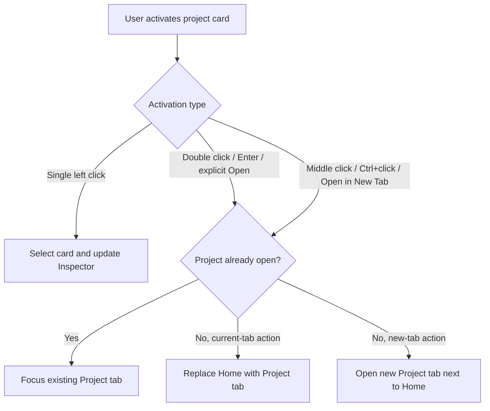
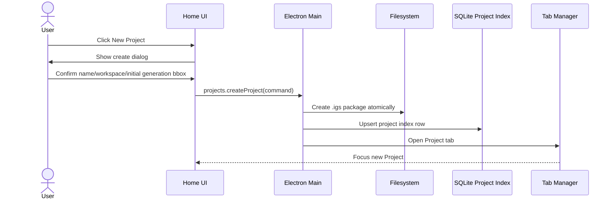
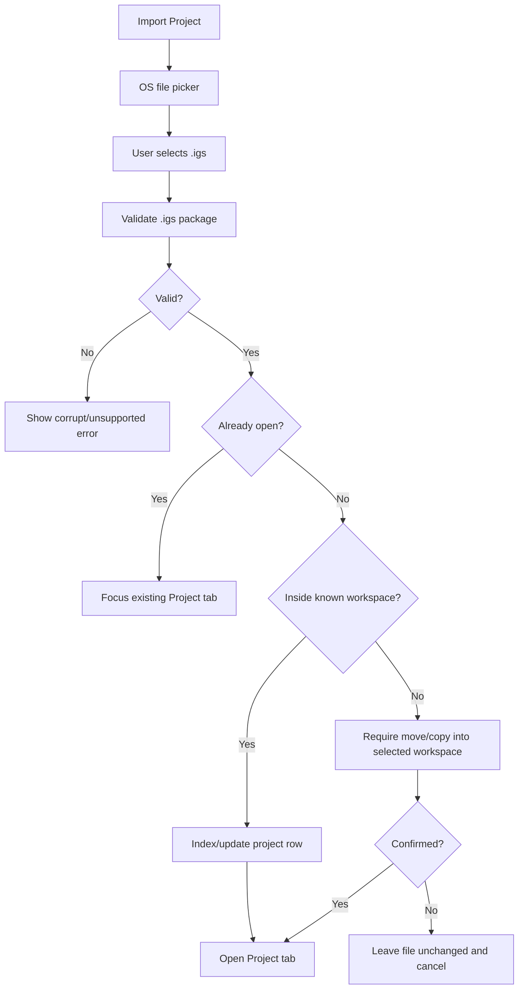
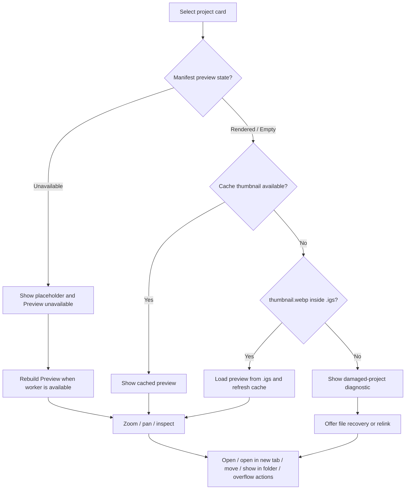
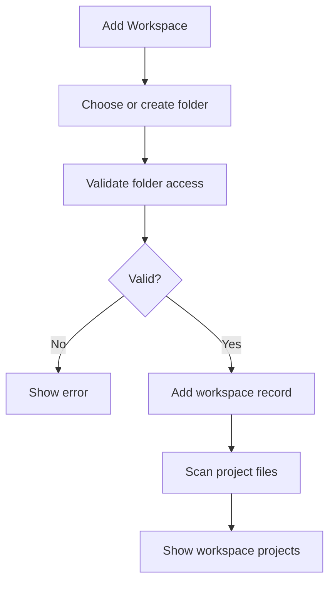

# Home Screen

## Production checkpoint

[Home grid/list and resize](../engineering/phase-4-home-grid-research.md) adds the approved Grid
and List controls to the real catalog. Both views retain the same selected Project
and saved preview; bounded sidebar/Inspector dividers redistribute space without
opening or saving. View, preferred widths and collapse survive Home remount within
the App session. Reset filters keeps view/sort; scope changes clear selection.
Cross-launch preferences, richer metadata and complete opening gestures remain
separate acceptance work.

[Selected Project Inspector](../engineering/phase-4-home-inspector-research.md) connects single-click/
keyboard list selection to the saved merged preview, independent of Open. Zoom/
pan/fit/reset use actual image dimensions; collapse survives Home remount for the
App session. Source-version capabilities refuse stale saved pixels even when a
thumbnail is unchanged. Only available summary metadata is shown; saved preview
is distinct from an open Project's unsaved composition. Grid, panel resize, richer
metadata and complete current/new-tab gestures remain separate consumers.

[Locate Folder](../engineering/phase-4-home-workspace-locate-research.md)
reconnects a missing non-default workspace to the exact cached saved-Project set.
One transaction preserves its workspace ID/name/color and all Project keys while
updating locations. Recovery stays at the same keys; later Open/Recover/Save is
explicit. The selected folder must contain all matching `.igs` filenames and no
extra `.igs`; incompatible/pending/Trash/orphan owners refuse the entire change.
`Uncategorized` retains its app-managed path. Wider compatibility/capacity and
Inspector/full preview remain separate acceptance work.

[Locate Project](../engineering/phase-4-home-project-locate-research.md) reconnects
a missing closed Project to its same saved document ID/revision in a registered
workspace. Explicit OS selection preserves the original local key and verified
document recovery; an unused scanned destination row can be replaced by that
owner. Independent owners and incompatible recovery refuse. Locate does not
import, open, Add or Save; later recovery uses the ordinary explicit flow.
Folder Locate has a later finite checkpoint above; broader Home presentation
remains open.

[Missing-file Remove from Home](../engineering/phase-4-home-missing-remove-research.md)
connects the missing row's menu to an explicit confirmation and guarded Main
transaction. It forgets only the derived Home entry after fresh absence checks in
an available workspace; location identity and recovery survive. Returning the
original file and Refresh rediscover the same key. Present files, unavailable
parents, open Projects and pending operations are refused. This checkpoint does
not qualify full Home/MVP acceptance; the later Locate checkpoint is separate.

[Production browse controls](../engineering/phase-4-home-project-browse-research.md)
connect name-only search, Last opened/Name/Modified sorting and independent
Open/Recovery available/Needs attention filters to actual Main metadata. Unknown
times stay last; equal values use stable name/identity ties. Reset clears search
and status while retaining sort. App-owned session state survives Home remount
and workspace/Projects/Trash switches, without a new persistent global setting.
Needs attention means unhealthy file or unavailable/absent workspace; recovery and
preview availability remain independent. Selection/Inspector/grid/full preview
remain separate consumers.

[Clean-open Rename](../engineering/phase-4-clean-open-rename-research.md) now keeps
the live Project tab and canvas Undo/Redo while changing title and filename.
Lifecycle name stays current through later Undo/Redo/Save. Dirty/unsynced drafts
still require explicit Save/close; same-live frozen Retry and normal Close/restart
use the existing positive journal and reservations. No implicit document Save.

[Open Project relocation](../engineering/phase-4-open-project-relocation-research.md)
extends the existing same-filesystem Move to clean open Projects while retaining
the same tab, Undo/Redo and package readers. Pending live moves fence edits and
generation until original-target Retry or explicit Close; startup recovers the
journal before scanning. Dirty Projects and unresolved document/generation
recovery are refused without implicit Save/close/discard.

Closed and clean-open saved Project Rename changes both title and `.igs` filename, preserving
assets/previews and immutable provenance. Pending Rename freezes the original
name; Open and conflicting operations stay blocked. Dirty Rename and
cross-filesystem transfer remain gaps. These finite checkpoints do not promote
PP-007 or complete the Home contract.

[Home locations](../engineering/phase-4-home-locations-research.md) connects Project
and workspace Show in Folder through validated Main-owned locations; no renderer
path is accepted. Project tabs use their Main-owned workspace ID and current catalog
color even while Home browses another scope. Native evidence uses controlled OS shell
callbacks; actual file-manager window UX is not qualified by that fixture.

[Project Trash](../engineering/phase-4-project-trash-research.md) connects the real
Home Trash scope, Restore and confirmed permanent deletion. Authoritative lifecycle
rows survive derived index loss and workspace unregister/re-Add. Open Projects and
unresolved operational generation/results block Trash/delete; original source paths
stay in place until confirmed permanent deletion. Pending purges retain recovery
intent across normal restart. Present unhealthy files without a trusted fingerprint are refused at Trash
publication; their broader lifecycle remains a Home continuation. See the research
note for executed evidence and limits.

[Workspace management](../engineering/phase-4-workspace-management-research.md)
adds name/color Settings and confirmed registration removal through real Main/SQLite
commands. Uncat name/removal are protected; any live Project blocks unregister.
Main serializes catalog lifecycle commands, and removal affects derived indexes
without deleting folders, Project files or operational generation/recovery data.
The [catalog/destinations stage](../engineering/phase-4-home-workspaces-research.md)
already connects Add, aggregate/scoped browsing and explicit Create/Import folders.
The later folder-Locate checkpoint above is separate from these registration
operations. Remaining Home presentation and full Home/MVP acceptance stay open.

## Feature

`Home` is the app's start and project-organization screen.

It lets the user:

- see all workspaces;
- browse all indexed projects across workspaces;
- sort indexed projects by last opened time, name or modified time;
- browse `.igs` projects inside a selected workspace;
- create a new project;
- import an existing `.igs` into a managed workspace and open it;
- preview a project before opening it;
- move projects between workspaces;
- diagnose missing/corrupt projects;
- open Model Manager;
- open Preset Manager;
- see compact generation/download activity indicators in the app chrome;
- open the shared `Saved generations` modal and navigate to an owning saved layer
  in any indexed ready Project (see [Results](./project/generate-mode/generation-results.md#app-level-saved-accepted-result-history)).

`Home` is not a marketing page, not an Invoke-like launchpad and not a reduced canvas. It is a document-management surface for a desktop creative tool.

## Reference

Primary UX references:

- Photoshop / Affinity / Krita home screens for document-centric start flow;
- desktop file managers for workspace/project browsing;
- browser tabs for open-project behavior;
- ImageGen Studio navigation decisions in `docs/specs/04-ui-ux-navigation.md`.

Current visual and interaction source of truth: the Vue/Naive Home at `/` / `?prototype=home` and `docs/prototype-app/tests/home.spec.ts`.

Reject as primary reference:

- InvokeAI `Launchpad`, `Viewer`, `Generate` top-level tab and permanent Boards sidebar. They mix generation, project browsing and preview affordances in ways that ImageGen Studio intentionally avoids.

## ImageGen Studio Decision

`Home` is a normal document tab in the app tab strip.

Rules:

- `Home` can be closed.
- The user can always reopen it from a Home button/menu action.
- If `Home` is already open, Home action focuses it.
- `Home` does not have the left/right Project panels used by `Project` tabs.
- `Home` has its own project-browser layout.
- Project organization lives on `Home`, not in a permanent Project-side Boards panel.

This keeps `Project` tabs focused on image work and keeps file/project organization in one predictable place.

Home follows [PP-002](../product-promises.md#pp-002-явное-намерение-вместо-магического-control) and [PP-003](../product-promises.md#pp-003-одна-сущность-один-владелец-и-одно-каноническое-место): `Search projects` only filters existing projects, while `New Project` and `Import Project` are explicit mutations. Workspaces own file locations; `Projects` is only a cross-workspace view and never becomes a competing container.

## Layout

Recommended MVP layout:

```text
Home tab
├─ App Chrome
│  ├─ horizontal product logo in the menu row
│  ├─ app menu
│  ├─ queue/download activity buttons
│  ├─ settings button
│  ├─ window controls
│  └─ document tabs
├─ Workspace Sidebar
│  ├─ New Project
│  ├─ Import Project
│  ├─ Projects
│  ├─ Trash
│  ├─ Uncategorized
│  ├─ user workspaces
│  ├─ add workspace
│  ├─ Manage Models
│  └─ Manage Presets
├─ Project Browser
│  ├─ active browse-view title and project count
│  ├─ refresh / workspace options
│  ├─ search
│  ├─ sort/view controls
│  └─ project grid/list
└─ Preview / Inspector
   ├─ project preview
   ├─ zoom / pan
   ├─ project metadata
   └─ project actions
```

The exact visual split can change during prototyping, but the functional zones should remain distinct:

- workspace selection;
- project browsing;
- project preview/inspection;
- app-level actions.

## Workspace Quick Actions

The primary Home actions live at the top of the Workspace Sidebar:

- `New Project`;
- `Import Project`.

`Manage Models` and `Manage Presets` remain reachable from a visually separated Tools group because they open app-level surfaces rather than changing the selected workspace.

`New Project` is the primary action for the Home/workspace context. The selected-project preview may also show a primary `Open Project` action, because it belongs to a separate selected-project context. This is allowed in the current prototype: the two primary buttons answer different user questions.

An empty-state `New Project` shortcut is secondary to the sidebar action.
An engine setup/repair notice also uses a neutral secondary action while Home
remains usable. An open creation/import dialog has its own primary confirmation.
Do not split an empty-state icon, message and shortcut into independent layout
items: they form one centered group within the project browser.

New Project and Project generation-area editing share the same resolution
control: aspect presets, width/height, ratio lock, swap and proportional preview.
Creation initializes the generation bbox; it does not establish finite canvas
bounds. Project-specific Fit actions stay with the editor that owns their context.

Normal healthy runtime state should not be shown as technical text. Avoid labels like `Worker ready`, `readonly`, `direct .igs files only` or `last scan`. Only show engine/model/worker state when it needs user attention, and use user-facing language such as `Generation is starting` or `Generation is unavailable`.

Home should not show a permanent app-readiness panel. Queue, downloads and settings are compact icon buttons in the app chrome. Recovery and scan details live in dedicated flows or overflow menus, not as default Home content.

## Audience And Language

Home is for people who want to generate and manage images, not necessarily for people who understand application internals.

Rules:

- prefer human-facing terms like `Preview`, `Size`, `Import Project`, `Open Project`, `Show in Folder`;
- avoid persistent labels like `Worker ready`, `readonly`, `runtime`, `direct .igs files only`, `last scan`;
- technical diagnostics may exist behind `Show details`, logs, recovery dialogs or developer views;
- when a technical state blocks work, explain the user impact first and the technical cause second.

## App Chrome

ImageGen Studio should use a custom Electron titlebar/chrome similar to T3Code:

- hide the system titlebar with Electron `titleBarStyle`;
- keep native window controls through `titleBarOverlay` in the real Electron app;
- make the app menu row and tab strip part of the draggable titlebar region;
- mark buttons, tabs, inputs and menus as no-drag regions;
- reserve the native window-controls area with `env(titlebar-area-*)` when the Window Controls Overlay is visible.

The Vue prototype draws presentational window controls so the shell communicates the intended chrome. Those controls do not override the Electron implementation rule above.

The horizontal app logo lives in the menu row. The current desktop density uses a 32px menu row and a 34px document-tab row. The logo is scaled to remain legible inside that compact chrome instead of reserving editor space for a 40px toolbar.

The Vue prototype uses a global 13px body/control foundation, 12px metadata and larger explicit section/dialog headings. This density applies across Home, Project and manager overlays so switching surfaces does not change the apparent UI scale.

Document tab markers use the source workspace color:

- each workspace has a user-editable color;
- Add Workspace offers a small named color palette and defaults the prototype draft to teal;
- project tabs from the same workspace use the same marker color;
- `Home` uses a home icon instead of a workspace color marker.

## Workspace Sidebar

Workspace is a flat folder containing `.igs` project files.

Rules:

- `Uncategorized` always exists as a real app-managed folder under `ImageGen Studio/workspaces/Uncategorized/`.
- A project created without an explicitly selected writable workspace is physically created in `Uncategorized`.
- An existing `.igs` outside known workspaces must be moved or copied into `Uncategorized` or another selected workspace before it is indexed and opened.
- `Uncategorized` is not a virtual grouping for arbitrary external file paths.
- A project belongs to exactly one workspace in the user-facing model.
- Workspaces are not nested.
- Nested folders inside a workspace are ignored by the workspace scanner.
- Files that are not `.igs` are ignored.
- A workspace can be missing or inaccessible; the UI must show a recoverable state instead of silently hiding it.

Workspace actions:

- create workspace;
- rename workspace;
- remove workspace registration without deleting its folder or project files;
- reveal workspace in file manager;
- rescan workspace;
- move project into another workspace.

Home does not delete workspace folders or their project files in MVP. `Remove Workspace` only forgets the workspace registration after confirmation. `Uncategorized` cannot be removed.

`Uncategorized` also cannot be renamed, but its color can be changed and it can still be revealed/rescanned. Removing another workspace is blocked while any project from it has an open document tab; after successful removal Home switches to `Uncategorized` and removes that workspace's cached project rows from the Home index only.

## Cross-Workspace View

The sidebar exposes one cross-workspace browse view above the concrete workspace list:

- `Projects` shows all indexed projects across workspaces using the active sort order.

`Projects` is a view, not a workspace. It does not receive a workspace color, cannot be renamed or removed and does not become a project destination. Project cards in this view show their source workspace. `Last opened` is its default sort, so a separate truncated `Recent` category is not needed.

## Project Browser

The project browser shows the active browse selection: all active projects in `Projects`, one concrete workspace, or app-managed `Trash`.

Project card/list item should show:

- thumbnail from `.igs` `preview/thumbnail.webp` or derived cache;
- project display name;
- workspace name on cross-workspace grid cards; compact list rows always include workspace and filename for orientation;
- last opened / modified time;
- applicable independent conditions such as `Open`;
- a subtle `Recovery available` marker only when a validated recovery candidate exists;
- missing/corrupt warning if applicable.

Controls:

- search by project display name only;
- sort by last opened, name or modified date;
- grid/list view toggle;
- filter by `Open`, `Recovery available` or `Needs attention`.

The filter control is labeled `Status` in the prototype, even though the underlying conditions remain independent rather than one mutually exclusive project-state enum. `All statuses` is its default value.

`Reset filters` clears Name search and Status only. It preserves the chosen sort and grid/list view mode. Changing between `Projects`, `Trash` and a workspace clears project selection but keeps those browser controls for the Home session.

Typing an unmatched name does not offer inline project creation. Creation and
import remain explicit actions with their own destination, validation and
lifecycle dialogs.

`Last opened` is the default sort and uses `lastOpenedAt`. `Modified` uses the last modification time of the `.igs` file. Search does not promise prompt, model or generation-setting indexing in MVP.

Project conditions are not a single mutually exclusive status enum. File health, runtime flags and workspace availability are independent and may be shown together. `Needs attention` matches missing, corrupt or unsupported projects and projects inside an unavailable workspace.

A missing thumbnail alone does not match `Needs attention`: it is a rebuildable preview-cache state and the project remains openable. `Recovery available` also has its own dedicated Status filter rather than being folded into attention.

Grid cards stack at most two opaque condition tags vertically over the preview; list rows show a compact single tag, while the Inspector can show the complete set. The tags use opaque Naive surfaces so warning text remains legible over arbitrary thumbnails.

The browser should be dense enough for repeated daily use. Avoid marketing-style hero cards or large decorative sections.

On desktop, the Workspace sidebar and Preview / Inspector are mouse-resizable with bounded widths. Resizing redistributes space to the Project Browser without changing browse selection or project state. The Inspector keeps its separate collapse action; while collapsed, its resize handle is unavailable.

Workspace scanning should not be a prominent daily workflow. The selected-workspace browser header exposes a compact refresh action and a workspace-options action that opens Workspace Settings. The full `Workspace Settings`, `Show in Folder`, `Rescan` and `Remove Workspace` menu remains attached to the corresponding sidebar row.

## Preview / Inspector

Selecting a project can show a preview without opening a `Project` tab.

When no project is selected, the Inspector shows a quiet `Select a project to preview` state. The Inspector can be resized or collapsed to give more space to the project grid or list.

Preview tools:

- zoom in/out;
- fit to view;
- pan;
- reset view;
- selected-project actions.

Preview must not show inactive canvas/generation controls. It is a viewer/inspector only.

Home's `Size` metadata for a Project refers to the saved primary generation bbox dimensions, not finite Project Canvas dimensions. The preview image may use a different finite visible-content rectangle. The current Vue cards still show bare width × height from their finite-canvas mock record; that label/data mapping must change with the infinite-canvas implementation.

Preview actions:

- open;
- open in new tab;
- move to workspace;
- show in folder.

If the selected project is already open, the primary action is labeled `Switch to Project` and focuses its existing tab instead of implying that another copy will be opened.

Less common actions live in the card/row context menu. In the current prototype it contains `Open`, `Open in New Tab`, `Rename`, `Move to Workspace`, `Show in Folder` and `Move to Trash`. Trash items instead expose `Restore` and `Delete Permanently`.

Crash recovery is intentionally not a permanent preview-panel action. The current prototype resolves it through the project-opening decision dialog. Home cards may show a subtle `Recovery available` marker for a validated unfinished recovery candidate, but normal autosave activity is not shown on Home.

The [production staging-only checkpoint](../engineering/phase-2b-staging-only-recovery-research.md)
also marks a closed ready Project with verified completed temporary results,
independently of document shadow and prunable Queue history. Open requires
Recover/Discard/Cancel before creating a tab. A clean staging-only Recover keeps
saved state clean; Cancel leaves the Project closed. With absent/clean document
shadow, an uninspectable staging store shows `Recovery unavailable` with a
diagnostic and permits saved Open/Import/Save/rebuild with warnings while keeping
unknown recovery files. Pending document recovery retains its existing status
and decision first; valid dirty Recover remains available with a warning.
Already-open Projects suppress recovery badges. These production checks are
separate from the prototype's in-memory recovery scenario.

## Project Opening Behavior

Opening projects follows browser-like tab semantics.

Rules:

- single left click selects the project and updates the Inspector without opening it;
- double click or `Enter` opens the selected project in the current tab;
- opening from `Home` replaces `Home` with the `Project` tab;
- middle click opens the project in a new tab next to `Home`;
- Ctrl/Cmd+click opens the project in a new tab;
- right click opens context menu;
- if the `.igs` is already open, any open action focuses the existing `Project` tab;
- duplicate tabs for the same `.igs` are categorically forbidden.



## First Run Flow

First run should be calm and task-oriented.

Expected empty states:

- no projects yet;
- only `Uncategorized` workspace exists;
- no model installed;
- CivitAI token missing.

The `first-run` Vue scenario models only Home-owned state: one `Uncategorized` workspace, no projects and no installed generation model. CivitAI token setup remains Model Manager-owned and is not varied by the Home scenario query.

The first-run Home should make the next useful actions obvious:

- create project;
- import existing `.igs`;
- manage models.

It should not force model installation before the user can organize projects, but it should clearly show that generation requires installed models.


## New Project Flow

Creating a project from Home:

1. User clicks `New Project`.
2. App opens a compact create dialog.
3. User chooses name, workspace and initial primary generation bbox dimensions/preset. The bbox starts at x=0, y=0; Project Canvas itself is unbounded. A concrete writable workspace selected on Home is used as the default; otherwise the dialog defaults to `Uncategorized`.
4. App creates a valid `.igs` project package.
5. App adds it to the selected workspace index.
6. App opens it as a `Project` tab with the viewport fitted to the initial bbox.

New project creation should not create an untitled invisible project outside a workspace. Every project file lives in a workspace folder from the start, and a project created without another explicit destination is physically created in `Uncategorized`.

The Vue prototype defaults to `No preset` and a finite 1024 × 1024 canvas; the product default is a primary generation bbox `{ x: 0, y: 0, width: 1024, height: 1024 }` on an unbounded canvas, with initial `Fit View`. The optional Generation preset selector shows Text to Image presets only. Selecting a preset creates an editable temporary payload through the shared `PresetPayloadEditor`; sections can be included, edited and reset without changing the saved preset. Seed is excluded by default. `Size` remains required but supplies primary bbox dimensions, not document bounds. All sections start collapsed, and missing resources warn without blocking project creation. `Expand all` / `Collapse all`, per-section reset and `Reset all` reuse the same payload-editor behavior as Apply.

Project-name validation is initially quiet. It becomes visible after the name field is edited or after a create attempt; opening the dialog with an untouched empty field does not immediately show an error.



## Import Existing Project Flow

Opening an existing `.igs` from file picker:

1. User clicks `Import Project`.
2. App shows OS file picker filtered to `.igs`.
3. Main process validates the selected file.
4. If valid, app checks the open-project registry.
5. If already open, focus existing tab.
6. If not open, create/focus a `Project` tab.
7. App indexes the project under its workspace if the path belongs to a known workspace.
8. If outside known workspaces, app requires the user to move or copy it into `Uncategorized` or another selected workspace before opening.

The app does not create an implicit workspace from the external file's parent and does not keep a virtual external-path entry in `Uncategorized`. Cancelling the destination step leaves the external file unchanged and does not index or open it.

The destination dialog defaults to `Move` and to the current concrete writable workspace; from `Projects`, `Trash` or an unavailable workspace it defaults to `Uncategorized`. The user can explicitly switch to `Copy` before confirming.



## App-Managed Trash

`Move to Trash` is a reversible ImageGen Studio lifecycle state rather than an immediate system deletion. Trashed projects retain authoritative lifecycle metadata independent of the derived Home index, disappear from Projects and workspace results, and appear in the dedicated Trash view. Their `.igs` file stays at its original path; unregistering a workspace does not silently restore them. Any currently open project is blocked from moving to Trash and offers `Switch to Project` instead.

Trash actions are:

- `Restore Project`, which returns the project to its previous workspace;
- `Delete Permanently`, which removes the indexed project and its managed file after destructive confirmation.

Open projects must still be closed before moving them to Trash. Workspace counters exclude trashed projects. Restore requires the original canonical folder to be registered and its source Project available; it never implicitly adds a workspace or redirects to Uncategorized. A permanent deletion that has committed but cannot finish stays visible as pending with Retry Delete and cannot be restored. Repairing access allows guarded startup recovery to finish that committed deletion.

## Read-Only Preview Flow

Preview is for inspection, not editing.

1. User selects a project card.
2. Home reads preview state from `.igs` and loads thumbnail/merged preview from
   cache or package when rendered/empty.
3. If the manifest marks preview `unavailable` after Save without ML Worker,
   Home shows the bundled placeholder and a subtle `Preview unavailable` state.
   `Rebuild Preview` with a working worker explicitly replaces embedded
   previews for a clean Project; if it is open and dirty, Home routes to
   Project Save. A cache refresh does not rewrite `.igs`.
4. If a derived cache preview is missing, Home reads the mandatory embedded
   preview from `.igs` and rebuilds the cache. If an embedded preview is missing,
   the package is corrupt; Home shows a damaged-project diagnostic rather than
   presenting a cache rebuild as a repair.
5. User can zoom/pan.
6. User can open the project or perform project file actions.



## Workspace Management Flow

Workspace creation:



The prototype simulates the folder picker with editable `Workspace name` and `Folder` fields prefilled as `Environment studies`, plus a five-color select. `Add Workspace` validates duplicate name/path, selects the new workspace and clears project selection.

Move project to workspace:

- move the `.igs` file atomically if source and target filesystem allow it;
- update SQLite project index after successful move;
- keep open `Project` tab identity in sync with the new canonical path;
- if project is open and dirty, require save or close before move unless implementation can safely coordinate autosave state.

In the prototype, a dirty open project is blocked with `Switch to Project`; a clean open project can be moved and its document-tab workspace marker is updated. Rename changes both display name and `.igs` filename and updates an existing tab title. When a move removes the project from the current concrete-workspace result set, Home clears the selection instead of choosing another card.

## Status And Recovery States

Home must make file/project problems visible without panic.

Project conditions are represented by independent dimensions:

- file health: `ready`, `missing`, `corrupt` or `unsupported_schema`;
- runtime/index flags: `open`, `recovery_available`, `thumbnail_missing`,
  `preview_unavailable` (derived from saved manifest state);
- workspace availability: `available`, `missing` or `inaccessible`.

`open` is derived from the runtime document-tab registry and is not persisted on the Home project record. Likewise, workspace availability is resolved from the workspace catalog rather than copied into every project.

This allows conditions such as an open project with a missing thumbnail without forcing the UI to choose one synthetic status.

State behavior in the current prototype:

- `open`: card shows open marker; opening focuses existing tab.
- `missing`: card remains visible from SQLite index and offers locate/relink/remove-from-index.
- `corrupt`: Inspector explains that opening is disabled and offers `Show in Folder`; technical error details are available only in the combined unavailable-workspace diagnostic path.
- `unsupported_schema`: Inspector explains that project was created by a newer app version and offers `Show in Folder`.
- `thumbnail_missing`: show fallback and rebuild cache if possible.
- `recovery_available`: show a subtle `Recovery available` marker and route recovery through the project-opening decision dialog.
- unavailable workspace: show a workspace-level warning and locate/remove options.

Production also distinguishes `preview_unavailable`: show the saved placeholder
with an explanation; opening remains available and explicit `Rebuild Preview`
can regenerate embedded previews after worker recovery. A dirty open Project
uses Save instead; failed rebuild leaves the old valid placeholder and never
changes dirty/undo. The current prototype has only
`thumbnailState: 'ready' | 'missing'`; its `Preview unavailable` label and in-memory rebuild currently mix
cache-miss with this separate saved-manifest condition.

Visible card/Inspector labels use human-facing copies: `Open`, `Recovery available`, `File missing`, `Corrupt project`, `Newer app required`, `Preview unavailable`, `Workspace unavailable` and `In Trash`. Internal enum tokens above are not shown directly.

### Autosave And Recovery Lifecycle

Normal autosave is an internal protection mechanism and is not a Home status. While a project is being edited, dirty project parts are written to a shadow directory without replacing the main `.igs`.

`recovery_available` is set only for a validated unfinished recovery candidate, normally detected after an unexpected shutdown. A normal save marks the shadow state clean or deletes it. A graceful `Discard Changes` also removes the discarded shadow state.

Opening a project with recovery available shows these choices:

- `Recover` opens the recovered state as a dirty `Project` document;
- `Discard Recovery and Open Saved` removes the recovery candidate and opens the saved `.igs`;
- `Cancel` returns to Home without changing either state.

Recovering never overwrites the main `.igs` automatically. The user reviews the recovered document and saves it explicitly.

## Integration With App-Level Systems

Model Manager:

- `Manage Models` opens Model Manager.
- If no model is installed, Home shows `No generation model installed. You can still create, open, and organize projects.` with a `Manage Models` action.
- Home must not duplicate Model Manager's resource list.

Queue / Downloads:

- Home can show compact queue/download activity buttons in the app chrome.
- The generation/upscale queue button opens Queue Manager.
- The downloads button opens Model Manager focused on `Downloading` / model install queue.
- Model downloads do not have a separate Download Manager in MVP.
- Home does not show a permanent queue panel.

Autosave / Recovery:

- Home marks only validated unfinished recovery candidates, not normal background autosave activity.
- The interactive prototype resolves recovery from the project-opening modal. A future global recovery entry point may reuse the same decision flow but is not demonstrated here.
- The recovered document opens as a normal `Project` tab.

Project Index:

- Home reads SQLite project index for fast startup.
- Workspace rescan can rebuild or repair the index from `.igs` files.
- `.igs` remains the source of truth for the project itself.

## Prototype Coverage And Accessibility

The Vue/Naive implementation and its Playwright tests are the source of truth for Home layout, labels and interactions: document tabs, selection, filtering, sorting, Inspector collapse/resize, dialogs, app-managed Trash and recovery behavior.

The prototype app opens Home at its root URL and also accepts `?prototype=home`. Initial states can be selected with `scenario=default`, `first-run`, `no-model` or `problems`.

There is no scenario selector in the user-facing Home UI; scenarios are query/test fixtures only.

The interactive prototype covers these switchable and interaction-reachable scenarios:

- populated workspace;
- first run with no projects;
- empty workspace;
- no model installed;
- no project selected;
- no search results;
- project already open;
- recovery available;
- missing, corrupt and unsupported project;
- missing workspace as the explicit unavailable-workspace example;
- missing thumbnail.

The query scenarios are intentionally coarse: `default` contains the regular catalog plus recovery, missing-file, missing-workspace and missing-thumbnail examples; `first-run` contains only `Uncategorized`, no projects and no installed model; `no-model` keeps the regular catalog and adds the model warning; `problems` adds corrupt and unsupported-schema projects. Empty-workspace and no-results states are reached through normal UI interactions rather than separate scenario ids.

For tab-semantics demonstration, the prototype initially keeps `Home`, `Sample Project B.igs` and `Sample Project A.igs` in the document strip. Those two mock Project tabs do not imply that production always starts with projects open. If every document tab is closed, the stage shows `No document open` with `Open Home`; the Home action restores Home at the beginning of the strip and preserves its mounted session state.

Prototype operations are in-memory simulations. `Import Project` starts from the fixed external `Field Notes.igs` example instead of an OS picker; add/rescan/locate/reveal/move/copy/Trash actions update mock state or show messages; creating/opening a project renders the shared Project context mock rather than a real `.igs` document. No filesystem, SQLite or Electron command is implied by the prototype implementation itself.

In App Chrome, the Home logo button and document tabs are interactive. File/Edit/Project/Models/Window/Help, queue/download/settings icons and drawn window controls are presentational placeholders in the Vue prototype; their production ownership is specified below but not wired in this playground.

The queue/download badges use fixed mock counts (`2` and `1`) to reserve chrome geometry; they are not live queue state.

Accessibility requirements:

- workspace and browse-view rows use keyboard-focusable selection semantics;
- project cards support single-click selection, `Enter` opening, modifier-assisted opening and an accessible context menu;
- each card/list row uses a semantic article shell with one full-surface Naive selection button and a separate non-nested actions button;
- document tabs expose tablist/tab semantics and separate accessible close buttons;
- search, sort, filter and view controls have visible labels or accessible names;
- selected, pressed, expanded, disabled and recovery states are exposed semantically rather than by color alone;
- all interactive elements have visible `focus-visible` treatment;
- Naive modals provide named dialogs and return focus to their trigger in ordinary dialog flows; when filtering, moving or removing hides the selected project, the prototype clears selection rather than silently selecting another project. Explicit nearest-card focus transfer after deletion is not modeled yet.

The Vue prototype is checked at 1920×1080, 1440×900 and 1280×800 without horizontal overflow. Bounded mouse resizing and the collapsible Inspector keep the project browser useful at the narrower supported desktop size.

## Not In MVP

MVP does not include:

- nested workspaces;
- cloud/sync/shared workspaces;
- multi-user collaboration;
- full image gallery unrelated to `.igs` projects;
- editing canvas or generation settings inside Home preview;
- marketplace content on Home;
- automatic deletion of project files when removing a workspace;
- Home-specific undo/redo.

## Acceptance Criteria

- User can open and close `Home` as a normal document tab.
- Home action focuses an existing `Home` tab or reopens it if closed.
- Closing every document shows a neutral empty-document state with `Open Home`.
- Closing/reopening Home within the prototype session preserves browse selection, search, Status, sort, view mode, selected project when still visible, and Inspector collapse/size state.
- Home shows `Projects` by default with no project selected.
- `Uncategorized` is a real app-managed workspace folder and is the default destination when no other workspace is selected.
- Home provides `Projects` as the cross-workspace view, sorted by last opened by default.
- `Projects`, a concrete workspace and `Trash` are mutually exclusive browse selections.
- Home provides an app-managed Trash view with restore and permanent-delete flows.
- User can create a new `.igs` project inside a workspace.
- User can import an existing `.igs` from Home.
- An external `.igs` must be moved or copied into a workspace before it is indexed and opened.
- Home may show `New Project` as the Home primary action and `Open Project` as the selected-project primary action.
- Opening an already-open `.igs` focuses the existing `Project` tab.
- Single click selects a project for preview; double click / Enter opens it in the current tab; middle click / Ctrl-click opens it in a new tab.
- Search matches project display names only; sorting supports last opened, name and modified date.
- Project filtering supports `Open`, `Recovery available` and `Needs attention` without treating independent conditions as one enum.
- Project cards show thumbnail, name, basic metadata and applicable independent conditions.
- A Project saved while ML Worker was unavailable remains openable and shows
  `Preview unavailable`, never a stale thumbnail represented as current.
- `Rebuild Preview` on a clean Project with a restored worker atomically updates
  the embedded preview and cache without changing document revision, dirty or
  undo. It serializes with Save and rechecks open Project identity/dirty just
  before replacement; a failure keeps the old valid `.igs` and placeholder.
  The current Vue prototype only flips an in-memory thumbnail state and does
  not prove this production behavior.
  The production Home list now loads the embedded thumbnail through a signed
  local resource and offers the explicit rebuild action for `unavailable`
  previews; Electron smoke verifies the resulting package and visible image.
  That preview slice did not establish the broader card selection, Inspector
  zoom/pan or grid. Production filters/sorts and workspace operations are covered
  by the newer checkpoints above; full selected-project preview remains open.
- Home preview supports zoom and pan without showing inactive generation/canvas controls, and its Inspector can be collapsed.
- Workspace sidebar and Inspector widths are mouse-resizable within bounded ranges; the Inspector resize handle is unavailable while collapsed.
- An already-open selected project uses `Switch to Project` and focuses its existing tab.
- User can create and rename workspaces; refresh/reveal-style maintenance actions are available via icon or overflow menu.
- User can remove a non-default workspace registration without deleting its folder or project files; `Uncategorized` cannot be removed.
- Workspace scan ignores nested folders and non-`.igs` files.
- Missing/corrupt/incompatible projects produce visible, non-opening diagnostic states with the actions demonstrated above.
- Normal autosave activity is invisible on Home; validated unfinished recovery state is shown as `Recovery available` and resolved through a dedicated recovery flow.
- The interactive Vue/Naive prototype covers populated, empty, recovery and file/workspace error states with keyboard-accessible primary controls. Selection is cleared when its project leaves the result set; post-removal nearest-card focus remains future polish.
- `Manage Models` opens Model Manager from Home.
- `Manage Presets` opens Preset Manager from Home.
- Both managers open as native Naive modal overlays, make Home inert underneath, close through their explicit close action or `Esc`, and preserve the mounted Home state after closing.
- Home does not include Invoke-like `Launchpad`, `Viewer` or permanent Boards sidebar.
