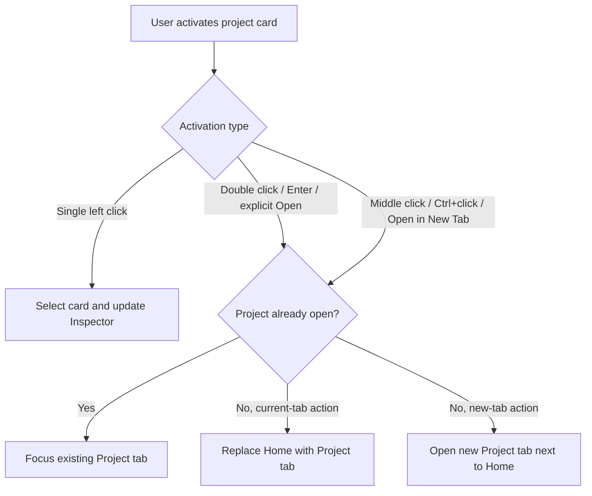
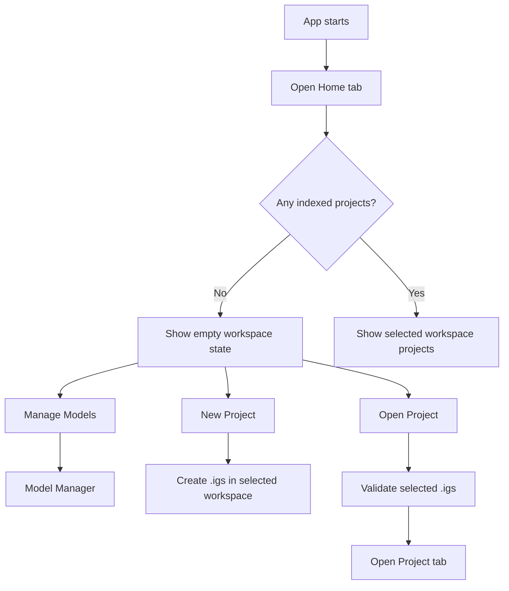
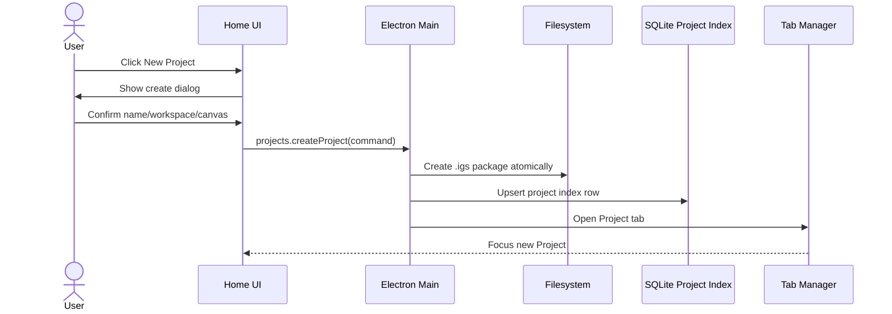
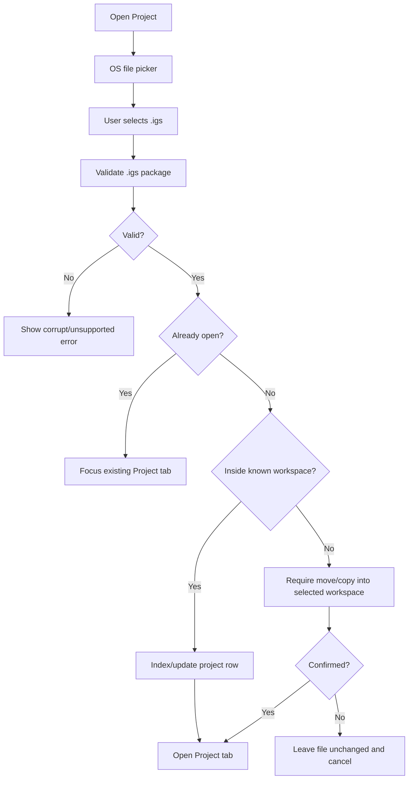
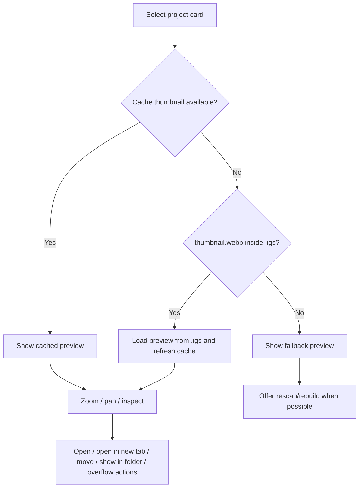
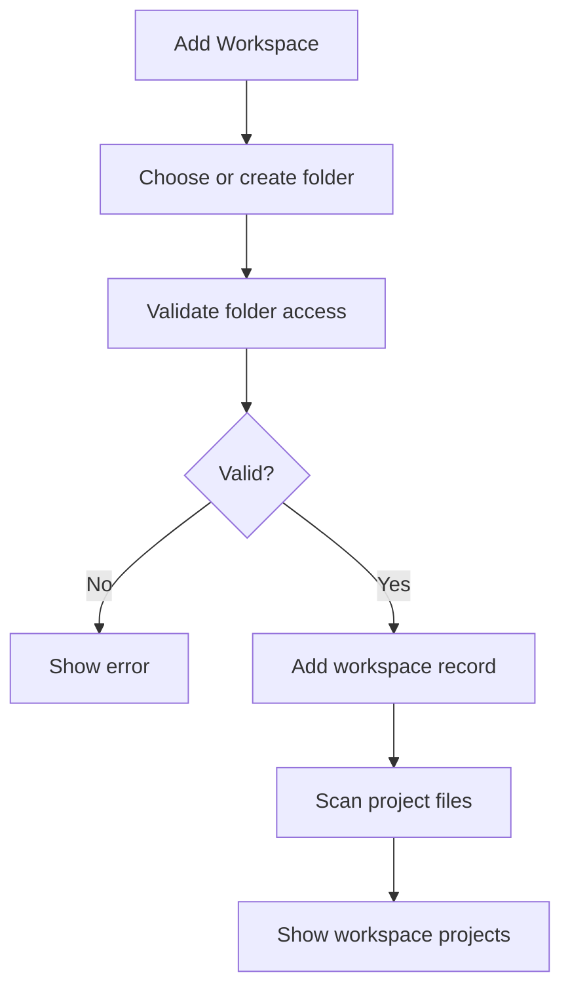

# Home Screen

## Feature

`Home` is the app's start and project-organization screen.

It lets the user:

- see all workspaces;
- return to recently opened projects across workspaces;
- browse all indexed projects across workspaces;
- browse `.igs` projects inside a selected workspace;
- create a new project;
- open an existing `.igs`;
- preview a project before opening it;
- move projects between workspaces;
- diagnose missing/corrupt projects;
- open Model Manager;
- see compact generation/download activity when something is happening.

`Home` is not a marketing page, not an Invoke-like launchpad and not a reduced canvas. It is a document-management surface for a desktop creative tool.

## Reference

Primary UX references:

- Photoshop / Affinity / Krita home screens for document-centric start flow;
- desktop file managers for workspace/project browsing;
- browser tabs for open-project behavior;
- ImageGen Studio navigation decisions in `docs/specs/04-ui-ux-navigation.md`.

Reject as primary reference:

- InvokeAI `Launchpad`, `Viewer`, `Generate` top-level tab and permanent Boards sidebar. They mix generation, project browsing and preview affordances in ways that ImageGen Studio intentionally avoids.

## ImageGen Studio Decision

`Home` is a normal document tab in the app tab strip.

Rules:

- `Home` can be closed.
- The user can always reopen it from a Home button/menu action.
- If `Home` is already open, Home action focuses it.
- `Home` does not have the left/right Project panels used by `Project` tabs.
- `Home` has its own project-browser layout.
- Project organization lives on `Home`, not in a permanent Project-side Boards panel.

This keeps `Project` tabs focused on image work and keeps file/project organization in one predictable place.

## Layout

Recommended MVP layout:

```text
Home tab
├─ App Chrome
│  ├─ horizontal product logo in the menu row
│  ├─ app menu
│  ├─ queue/download activity buttons
│  ├─ settings button
│  ├─ window controls
│  └─ document tabs
├─ Workspace Sidebar
│  ├─ New Project
│  ├─ Open Project
│  ├─ Recent
│  ├─ All Projects
│  ├─ Uncategorized
│  ├─ user workspaces
│  ├─ add workspace
│  └─ Manage Models
├─ Project Browser
│  ├─ selected workspace title
│  ├─ refresh / workspace options
│  ├─ search
│  ├─ sort/view controls
│  └─ project grid/list
└─ Preview / Inspector
   ├─ project preview
   ├─ zoom / pan
   ├─ project metadata
   └─ project actions
```

The exact visual split can change during prototyping, but the functional zones should remain distinct:

- workspace selection;
- project browsing;
- project preview/inspection;
- app-level actions.

## Workspace Quick Actions

The primary Home actions live at the top of the Workspace Sidebar:

- `New Project`;
- `Open Project`.

`Manage Models` remains reachable from Home but is visually separated from workspace-scoped actions because it opens an app-level surface rather than changing the selected workspace.

`New Project` is the primary action for the Home/workspace context. The selected-project preview may also show a primary `Open Project` action, because it belongs to a separate selected-project context. This is allowed in the current prototype: the two primary buttons answer different user questions.

Normal healthy runtime state should not be shown as technical text. Avoid labels like `Worker ready`, `readonly`, `direct .igs files only` or `last scan`. Only show engine/model/worker state when it needs user attention, and use user-facing language such as `Generation is starting` or `Generation is unavailable`.

Home should not show a permanent app-readiness panel. Queue, downloads and settings are compact icon buttons in the app chrome. Recovery and scan details live in dedicated flows or overflow menus, not as default Home content.

## Audience And Language

Home is for people who want to generate and manage images, not necessarily for people who understand application internals.

Rules:

- prefer human-facing terms like `Preview`, `Size`, `Open Project`, `Show in Folder`;
- avoid persistent labels like `Worker ready`, `readonly`, `runtime`, `direct .igs files only`, `last scan`;
- technical diagnostics may exist behind `Show details`, logs, recovery dialogs or developer views;
- when a technical state blocks work, explain the user impact first and the technical cause second.

## App Chrome

ImageGen Studio should use a custom Electron titlebar/chrome similar to T3Code:

- hide the system titlebar with Electron `titleBarStyle`;
- keep native window controls through `titleBarOverlay` in the real Electron app;
- make the app menu row and tab strip part of the draggable titlebar region;
- mark buttons, tabs, inputs and menus as no-drag regions;
- reserve the native window-controls area with `env(titlebar-area-*)` when the Window Controls Overlay is visible.

The HTML prototype may draw static window-control buttons so the layout communicates the intended chrome. That visual placeholder does not override the Electron implementation rule above.

The horizontal app logo lives in the menu row. The menu row should be tall enough, around 40px, for the logo to stay legible without making the chrome feel heavy.

Document tab markers use the source workspace color:

- each workspace has a user-editable color;
- new workspaces get a generated default color;
- project tabs from the same workspace use the same marker color;
- `Home` uses a home icon instead of a workspace color marker.

## Workspace Sidebar

Workspace is a flat folder containing `.igs` project files.

Rules:

- `Uncategorized` always exists as a real app-managed folder under `ImageGen Studio/workspaces/Uncategorized/`.
- A project created without an explicitly selected writable workspace is physically created in `Uncategorized`.
- An existing `.igs` outside known workspaces must be moved or copied into `Uncategorized` or another selected workspace before it is indexed and opened.
- `Uncategorized` is not a virtual grouping for arbitrary external file paths.
- A project belongs to exactly one workspace in the user-facing model.
- Workspaces are not nested.
- Nested folders inside a workspace are ignored by the workspace scanner.
- Files that are not `.igs` are ignored.
- A workspace can be missing or inaccessible; the UI must show a recoverable state instead of silently hiding it.

Workspace actions:

- create workspace;
- rename workspace;
- remove workspace registration without deleting its folder or project files;
- reveal workspace in file manager;
- rescan workspace;
- move project into another workspace.

Home does not delete workspace folders or their project files in MVP. `Remove Workspace` only forgets the workspace registration after confirmation. `Uncategorized` cannot be removed.

## Cross-Workspace Views

The sidebar exposes two browse views above the concrete workspace list:

- `Recent` shows projects from all workspaces ordered by `lastOpenedAt` descending;
- `All Projects` shows all indexed projects across workspaces using the active sort order.

These are views, not workspaces. They do not receive workspace colors, cannot be renamed or removed and do not become project destinations. Project cards in both views show their source workspace.

## Project Browser

The project browser shows projects from the selected workspace.

Project card/list item should show:

- thumbnail from `.igs` `preview/thumbnail.webp` or derived cache;
- project display name;
- workspace name if shown in all/recent views;
- last opened / modified time;
- applicable independent conditions such as `Open`;
- a subtle `Recovery available` marker only when a validated recovery candidate exists;
- missing/corrupt warning if applicable.

Controls:

- search by project display name only;
- sort by last opened, name or modified date;
- grid/list view toggle;
- filter by `Open`, `Recovery available` or `Needs attention`.

`Last opened` is the default sort and uses `lastOpenedAt`. `Modified` uses the last modification time of the `.igs` file. Search does not promise prompt, model or generation-setting indexing in MVP.

Project conditions are not a single mutually exclusive status enum. File health, runtime flags and workspace availability are independent and may be shown together. `Needs attention` matches missing, corrupt or unsupported projects and projects inside an unavailable workspace.

The browser should be dense enough for repeated daily use. Avoid marketing-style hero cards or large decorative sections.

Workspace scanning should not be a prominent daily workflow. Home may expose a small refresh icon for the selected workspace and keep heavier scan/relink actions in a workspace overflow menu.

## Preview / Inspector

Selecting a project can show a preview without opening a `Project` tab.

When no project is selected, the Inspector shows a quiet `Select a project to preview` state. The Inspector can be collapsed to give more space to the project grid or list.

Preview tools:

- zoom in/out;
- fit to view;
- pan;
- reset view;
- selected-project actions.

Preview must not show inactive canvas/generation controls. It is a viewer/inspector only.

Preview actions:

- open;
- open in new tab;
- move to workspace;
- show in folder.

If the selected project is already open, the primary action is labeled `Switch to Project` and focuses its existing tab instead of implying that another copy will be opened.

Less common actions such as rename, delete and relink may live in the preview overflow/context menu instead of being permanent visible buttons.

Crash recovery is intentionally not a permanent preview-panel action. Recovery belongs in `File -> Recover Autosaves...`, the startup flow or a project-opening decision dialog. Home cards may show a subtle `Recovery available` marker for a validated unfinished recovery candidate, but normal autosave activity is not shown on Home.

## Project Opening Behavior

Opening projects follows browser-like tab semantics.

Rules:

- single left click selects the project and updates the Inspector without opening it;
- double click or `Enter` opens the selected project in the current tab;
- opening from `Home` replaces `Home` with the `Project` tab;
- middle click opens the project in a new tab next to `Home`;
- Ctrl/Cmd+click opens the project in a new tab;
- right click opens context menu;
- if the `.igs` is already open, any open action focuses the existing `Project` tab;
- duplicate tabs for the same `.igs` are categorically forbidden.



## First Run Flow

First run should be calm and task-oriented.

Expected empty states:

- no projects yet;
- only `Uncategorized` workspace exists;
- no model installed;
- CivitAI token missing.

The first-run Home should make the next useful actions obvious:

- create project;
- open existing `.igs`;
- manage models.

It should not force model installation before the user can organize projects, but it should clearly show that generation requires installed models.



## New Project Flow

Creating a project from Home:

1. User clicks `New Project`.
2. App opens a compact create dialog.
3. User chooses name, workspace and initial canvas size/preset. A concrete writable workspace selected on Home is used as the default; otherwise the dialog defaults to `Uncategorized`.
4. App creates a valid `.igs` project package.
5. App adds it to the selected workspace index.
6. App opens it as a `Project` tab.

New project creation should not create an untitled invisible project outside a workspace. Every project file lives in a workspace folder from the start, and a project created without another explicit destination is physically created in `Uncategorized`.



## Open Existing Project Flow

Opening an existing `.igs` from file picker:

1. User clicks `Open Project`.
2. App shows OS file picker filtered to `.igs`.
3. Main process validates the selected file.
4. If valid, app checks the open-project registry.
5. If already open, focus existing tab.
6. If not open, create/focus a `Project` tab.
7. App indexes the project under its workspace if the path belongs to a known workspace.
8. If outside known workspaces, app requires the user to move or copy it into `Uncategorized` or another selected workspace before opening.

The app does not create an implicit workspace from the external file's parent and does not keep a virtual external-path entry in `Uncategorized`. Cancelling the destination step leaves the external file unchanged and does not index or open it.



## Read-Only Preview Flow

Preview is for inspection, not editing.

1. User selects a project card.
2. Home loads thumbnail/merged preview from cache or `.igs`.
3. If preview is missing, Home shows fallback state and can rebuild from `.igs` when possible.
4. User can zoom/pan.
5. User can open the project or perform project file actions.



## Workspace Management Flow

Workspace creation:



Move project to workspace:

- move the `.igs` file atomically if source and target filesystem allow it;
- update SQLite project index after successful move;
- keep open `Project` tab identity in sync with the new canonical path;
- if project is open and dirty, require save or close before move unless implementation can safely coordinate autosave state.

## Status And Recovery States

Home must make file/project problems visible without panic.

Project conditions are represented by independent dimensions:

- file health: `ready`, `missing`, `corrupt` or `unsupported_schema`;
- runtime flags: `open`, `recovery_available`, `thumbnail_missing`;
- workspace availability: `available`, `missing` or `inaccessible`.

This allows conditions such as an open project with a missing thumbnail without forcing the UI to choose one synthetic status.

State behavior:

- `open`: card shows open marker; opening focuses existing tab.
- `missing`: card remains visible from SQLite index and offers locate/relink/remove-from-index.
- `corrupt`: card offers show error details and reveal in file manager.
- `unsupported_schema`: card explains that project was created by a newer app version.
- `thumbnail_missing`: show fallback and rebuild cache if possible.
- `recovery_available`: show a subtle `Recovery available` marker and route recovery through `File -> Recover Autosaves...` or the project-opening flow.
- unavailable workspace: show a workspace-level warning and locate/remove options.

### Autosave And Recovery Lifecycle

Normal autosave is an internal protection mechanism and is not a Home status. While a project is being edited, dirty project parts are written to a shadow directory without replacing the main `.igs`.

`recovery_available` is set only for a validated unfinished recovery candidate, normally detected after an unexpected shutdown. A normal save marks the shadow state clean or deletes it. A graceful `Discard Changes` also removes the discarded shadow state.

Opening a project with recovery available shows these choices:

- `Recover` opens the recovered state as a dirty `Project` document;
- `Discard Recovery and Open Saved` removes the recovery candidate and opens the saved `.igs`;
- `Cancel` returns to Home without changing either state.

Recovering never overwrites the main `.igs` automatically. The user reviews the recovered document and saves it explicitly.

## Integration With App-Level Systems

Model Manager:

- `Manage Models` opens Model Manager.
- If no model is installed, Home may show a subtle, user-facing warning and an action to open Model Manager.
- Home must not duplicate Model Manager's resource list.

Queue / Downloads:

- Home can show compact queue/download activity buttons in the app chrome.
- The generation/upscale queue button opens Queue Manager.
- The downloads button opens Model Manager focused on `Downloading` / model install queue.
- Model downloads do not have a separate Download Manager in MVP.
- Home does not show a permanent queue panel.

Autosave / Recovery:

- Home marks only validated unfinished recovery candidates, not normal background autosave activity.
- Recovery belongs to `File -> Recover Autosaves...`, startup/opening flow or a dedicated recovery modal.
- The recovered document opens as a normal `Project` tab.

Project Index:

- Home reads SQLite project index for fast startup.
- Workspace rescan can rebuild or repair the index from `.igs` files.
- `.igs` remains the source of truth for the project itself.

## Prototype Coverage And Accessibility

The standalone HTML prototype remains a static visual reference. Interactive selection, filtering, sorting, Inspector collapse, dialogs and recovery behavior should be implemented and validated in the Vue/Naive prototype rather than simulated with ad-hoc HTML scripts.

The interactive prototype should cover these switchable scenarios:

- populated workspace;
- first run with no projects;
- empty workspace;
- no model installed;
- no project selected;
- no search results;
- project already open;
- recovery available;
- missing, corrupt and unsupported project;
- missing or inaccessible workspace;
- missing thumbnail.

Accessibility requirements:

- workspace and browse-view rows use keyboard-focusable selection semantics;
- project cards support single-click selection, `Enter` opening, modifier-assisted opening and an accessible context menu;
- document tabs expose tablist/tab semantics and separate accessible close buttons;
- search, sort, filter and view controls have visible labels or accessible names;
- selected, pressed, expanded, disabled and recovery states are exposed semantically rather than by color alone;
- all interactive elements have visible `focus-visible` treatment;
- focus moves predictably when dialogs open or close and when the selected project disappears after filtering or removal.

The Vue prototype should be checked at 1920×1080, 1440×900 and 1280×800 without horizontal overflow. The Inspector is collapsible so the project browser remains useful at the narrower supported desktop size.

## Not In MVP

MVP does not include:

- nested workspaces;
- cloud/sync/shared workspaces;
- multi-user collaboration;
- full image gallery unrelated to `.igs` projects;
- editing canvas or generation settings inside Home preview;
- marketplace content on Home;
- automatic deletion of project files when removing a workspace;
- Home-specific undo/redo.

## Acceptance Criteria

- User can open and close `Home` as a normal document tab.
- Home action focuses an existing `Home` tab or reopens it if closed.
- Home shows `Uncategorized` by default.
- `Uncategorized` is a real app-managed workspace folder and is the default destination when no other workspace is selected.
- Home provides `Recent` and `All Projects` cross-workspace views.
- User can create a new `.igs` project inside a workspace.
- User can open an existing `.igs` from Home.
- An external `.igs` must be moved or copied into a workspace before it is indexed and opened.
- Home may show `New Project` as the workspace primary action and `Open Project` as the selected-project primary action.
- Opening an already-open `.igs` focuses the existing `Project` tab.
- Single click selects a project for preview; double click / Enter opens it in the current tab; middle click / Ctrl-click opens it in a new tab.
- Search matches project display names only; sorting supports last opened, name and modified date.
- Project filtering supports `Open`, `Recovery available` and `Needs attention` without treating independent conditions as one enum.
- Project cards show thumbnail, name, basic metadata and applicable independent conditions.
- Home preview supports zoom and pan without showing inactive generation/canvas controls, and its Inspector can be collapsed.
- An already-open selected project uses `Switch to Project` and focuses its existing tab.
- User can create and rename workspaces; refresh/reveal-style maintenance actions are available via icon or overflow menu.
- User can remove a non-default workspace registration without deleting its folder or project files; `Uncategorized` cannot be removed.
- Workspace scan ignores nested folders and non-`.igs` files.
- Missing/corrupt/incompatible projects produce visible recoverable states.
- Normal autosave activity is invisible on Home; validated unfinished recovery state is shown as `Recovery available` and resolved through a dedicated recovery flow.
- The interactive Vue/Naive prototype covers populated, empty, recovery and file/workspace error states with keyboard-accessible controls and predictable focus behavior.
- `Manage Models` opens Model Manager from Home.
- Home does not include Invoke-like `Launchpad`, `Viewer` or permanent Boards sidebar.
