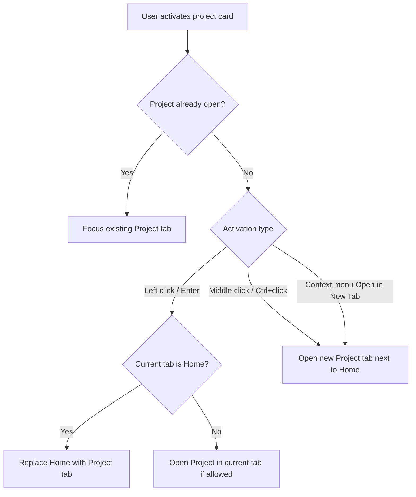
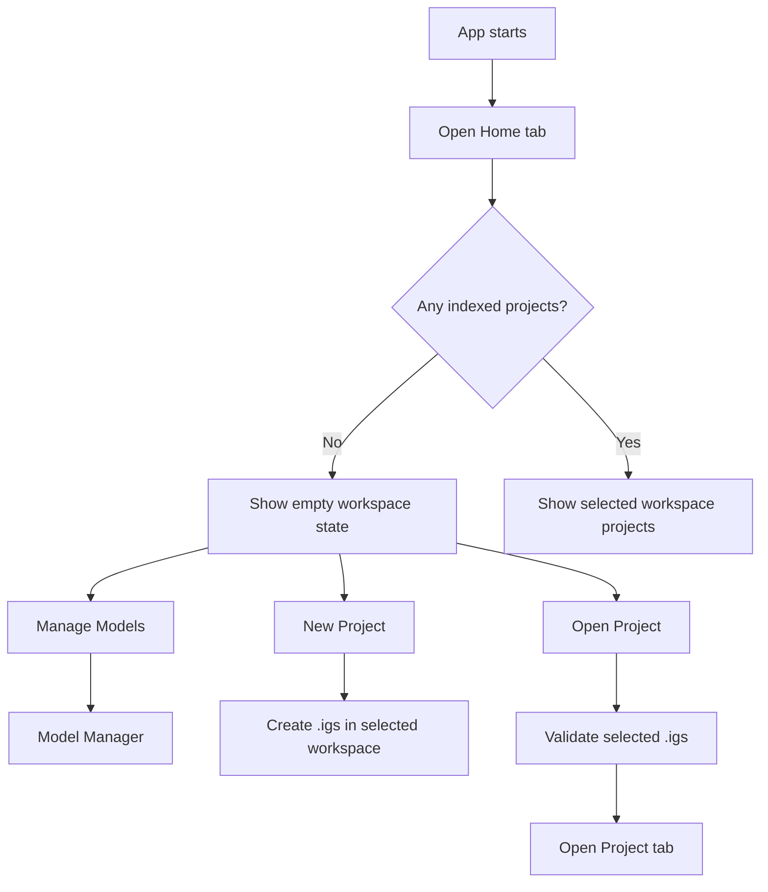
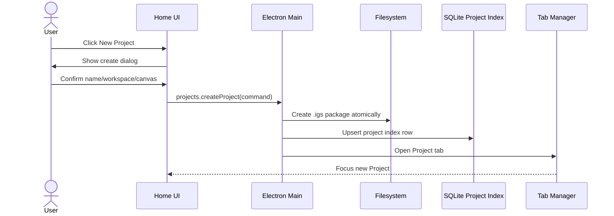
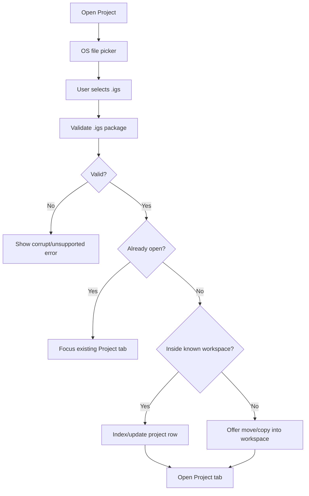
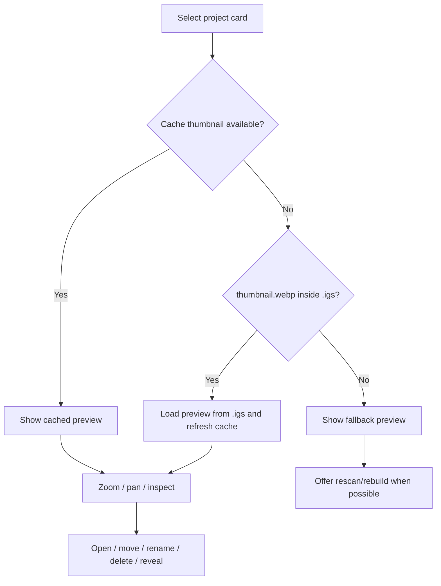
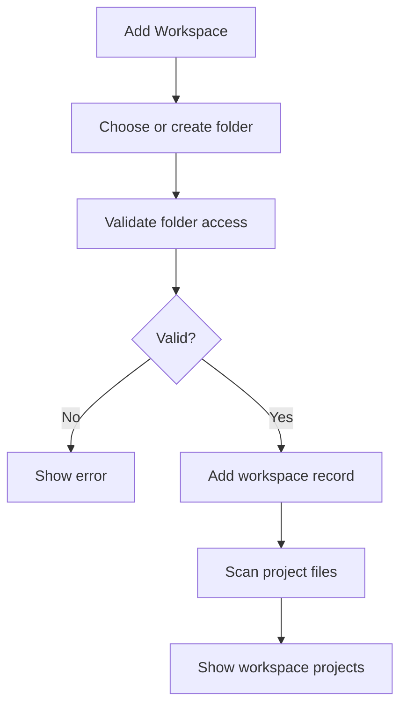

# Home Screen

## Feature

`Home` is the app's start and project-organization screen.

It lets the user:

- see all workspaces;
- browse `.igs` projects inside a selected workspace;
- create a new project;
- open an existing `.igs`;
- preview a project before opening it;
- move projects between workspaces;
- diagnose missing/corrupt projects;
- open Model Manager;
- see compact generation/download activity when something is happening.

`Home` is not a marketing page, not an Invoke-like launchpad and not a reduced canvas. It is a document-management surface for a desktop creative tool.

## Reference

Primary UX references:

- Photoshop / Affinity / Krita home screens for document-centric start flow;
- desktop file managers for workspace/project browsing;
- browser tabs for open-project behavior;
- ImageGen Studio navigation decisions in `docs/specs/04-ui-ux-navigation.md`.

Reject as primary reference:

- InvokeAI `Launchpad`, `Viewer`, `Generate` top-level tab and permanent Boards sidebar. They mix generation, project browsing and preview affordances in ways that ImageGen Studio intentionally avoids.

## ImageGen Studio Decision

`Home` is a normal document tab in the app tab strip.

Rules:

- `Home` can be closed.
- The user can always reopen it from a Home button/menu action.
- If `Home` is already open, Home action focuses it.
- `Home` does not have the left/right Project panels used by `Project` tabs.
- `Home` has its own project-browser layout.
- Project organization lives on `Home`, not in a permanent Project-side Boards panel.

This keeps `Project` tabs focused on image work and keeps file/project organization in one predictable place.

## Layout

Recommended MVP layout:

```text
Home tab
├─ App Chrome
│  ├─ app menu
│  ├─ document tabs
│  ├─ queue/download activity buttons
│  ├─ native window controls overlay
│  └─ horizontal product logo in the menu row
├─ Home Header
│  ├─ New Project
│  ├─ Open Project
│  ├─ Manage Models
├─ Workspace Sidebar
│  ├─ Uncategorized
│  ├─ user workspaces
│  └─ add workspace
├─ Project Browser
│  ├─ search
│  ├─ sort/view controls
│  ├─ recent projects strip or filter
│  └─ project grid/list
└─ Preview / Inspector
   ├─ project preview
   ├─ zoom / pan
   ├─ project metadata
   └─ project actions
```

The exact visual split can change during prototyping, but the functional zones should remain distinct:

- workspace selection;
- project browsing;
- project preview/inspection;
- app-level actions.

## Header

Header actions:

- `New Project`;
- `Open Project`;
- `Manage Models`;
- queue/download status button;
- app settings/menu action.

The header should not duplicate project editing controls. It should stay focused on app-level and project-opening actions.

Normal healthy runtime state should not be shown as technical text. Avoid labels like `Worker ready`, `readonly`, `direct .igs files only` or `last scan`. Only show engine/model/worker state when it needs user attention, and use user-facing language such as `Generation is starting` or `Generation is unavailable`.

## App Chrome

ImageGen Studio should use a custom Electron titlebar/chrome similar to T3Code:

- hide the system titlebar with Electron `titleBarStyle`;
- keep native window controls through `titleBarOverlay` instead of drawing custom close/minimize/maximize buttons in MVP;
- make the app menu row and tab strip part of the draggable titlebar region;
- mark buttons, tabs, inputs and menus as no-drag regions;
- reserve the native window-controls area with `env(titlebar-area-*)` when the Window Controls Overlay is visible.

The horizontal app logo lives in the menu row. The menu row should be tall enough, around 40px, for the logo to stay legible without making the chrome feel heavy.

Document tab markers use the source workspace color:

- each workspace has a user-editable color;
- new workspaces get a generated default color;
- project tabs from the same workspace use the same marker color;
- `Home` uses a home icon instead of a workspace color marker.

## Workspace Sidebar

Workspace is a flat folder containing `.igs` project files.

Rules:

- `Uncategorized` always exists.
- A project belongs to exactly one workspace in the user-facing model.
- Workspaces are not nested.
- Nested folders inside a workspace are ignored by the workspace scanner.
- Files that are not `.igs` are ignored.
- A workspace can be missing or inaccessible; the UI must show a recoverable state instead of silently hiding it.

Workspace actions:

- create workspace;
- rename workspace;
- delete workspace;
- reveal workspace in file manager;
- rescan workspace;
- move project into another workspace.

Deleting a workspace must not silently delete project files. MVP should either block deletion while it contains projects or require an explicit destructive confirmation.

## Project Browser

The project browser shows projects from the selected workspace.

Project card/list item should show:

- thumbnail from `.igs` `preview/thumbnail.webp` or derived cache;
- project display name;
- workspace name if shown in all/recent views;
- last opened / modified time;
- project status;
- subtle autosave marker if autosave state exists;
- missing/corrupt warning if applicable.

Controls:

- search;
- sort by recent, name, modified date;
- grid/list view toggle;
- filter by status;
- optional `Recent` view across workspaces.

The browser should be dense enough for repeated daily use. Avoid marketing-style hero cards or large decorative sections.

Workspace scanning should not be a prominent daily workflow. Home may expose a small refresh icon for the selected workspace and keep heavier scan/relink actions in a workspace overflow menu.

## Preview / Inspector

Selecting a project can show a preview without opening a `Project` tab.

Preview tools:

- zoom in/out;
- fit to view;
- pan;
- reset view;
- optional open/reveal actions.

Preview must not show inactive canvas/generation controls. It is a viewer/inspector only.

Preview actions:

- open;
- open in new tab;
- reveal in file manager;
- rename;
- move to workspace;
- delete;
- rescan/relink if missing.

Autosave recovery is intentionally not a permanent preview-panel action. Recovery belongs in `File -> Recover Autosaves...`, a startup/opening-flow modal or a project-opening decision dialog. Home cards may show a subtle `Autosave` status marker, but should not show an inline recovery warning block that competes with normal project browsing.

## Project Opening Behavior

Opening projects follows browser-like tab semantics.

Rules:

- left click opens the project in the current tab;
- if current tab is `Home`, `Home` is replaced by the `Project` tab;
- middle click opens the project in a new tab next to `Home`;
- Ctrl/Cmd+click opens the project in a new tab;
- right click opens context menu;
- if the `.igs` is already open, any open action focuses the existing `Project` tab;
- duplicate tabs for the same `.igs` are categorically forbidden.



## First Run Flow

First run should be calm and task-oriented.

Expected empty states:

- no projects yet;
- only `Uncategorized` workspace exists;
- no model installed;
- CivitAI token missing.

The first-run Home should make the next useful actions obvious:

- create project;
- open existing `.igs`;
- manage models.

It should not force model installation before the user can organize projects, but it should clearly show that generation requires installed models.



## New Project Flow

Creating a project from Home:

1. User clicks `New Project`.
2. App opens a compact create dialog.
3. User chooses name, workspace and initial canvas size/preset.
4. App creates a valid `.igs` project package.
5. App adds it to the selected workspace index.
6. App opens it as a `Project` tab.

New project creation should not create an untitled invisible project outside a workspace. Every project file should live in a workspace folder from the start.



## Open Existing Project Flow

Opening an existing `.igs` from file picker:

1. User clicks `Open Project`.
2. App shows OS file picker filtered to `.igs`.
3. Main process validates the selected file.
4. If valid, app checks the open-project registry.
5. If already open, focus existing tab.
6. If not open, create/focus a `Project` tab.
7. App indexes the project under its workspace if the path belongs to a known workspace.
8. If outside known workspaces, app should offer to move/copy it into a workspace or remember its parent as a workspace depending on future policy.

For MVP, prefer moving/copying into a selected workspace over creating an implicit workspace silently.



## Read-Only Preview Flow

Preview is for inspection, not editing.

1. User selects a project card.
2. Home loads thumbnail/merged preview from cache or `.igs`.
3. If preview is missing, Home shows fallback state and can rebuild from `.igs` when possible.
4. User can zoom/pan.
5. User can open the project or perform project file actions.



## Workspace Management Flow

Workspace creation:



Move project to workspace:

- move the `.igs` file atomically if source and target filesystem allow it;
- update SQLite project index after successful move;
- keep open `Project` tab identity in sync with the new canonical path;
- if project is open and dirty, require save or close before move unless implementation can safely coordinate autosave state.

## Status And Recovery States

Home must make file/project problems visible without panic.

Project states:

- `ready`;
- `open`;
- `missing`;
- `corrupt`;
- `unsupported_schema`;
- `thumbnail_missing`;
- `autosave_available`;
- `workspace_missing`;
- `workspace_inaccessible`.

State behavior:

- `open`: card shows open marker; opening focuses existing tab.
- `missing`: card remains visible from SQLite index and offers locate/relink/remove-from-index.
- `corrupt`: card offers show error details and reveal in file manager.
- `unsupported_schema`: card explains that project was created by a newer app version.
- `thumbnail_missing`: show fallback and rebuild cache if possible.
- `autosave_available`: show a subtle project marker and route recovery through `File -> Recover Autosaves...` or the project-opening flow.
- `workspace_missing`: show workspace-level warning and rescan/relink options.

## Integration With App-Level Systems

Model Manager:

- `Manage Models` opens Model Manager.
- If no model is installed, Home may show a subtle app-readiness warning and an action to open Model Manager.
- Home must not duplicate Model Manager's resource list.

Queue / Downloads:

- Home can show compact queue/download activity buttons in the app chrome.
- Clicking it opens the app-level Queue/Downloads surface.
- Home does not show a permanent queue panel.

Autosave / Recovery:

- Home may mark a project that has autosave data, but it must not show recovery as a noisy always-visible warning.
- Recovery belongs to `File -> Recover Autosaves...`, startup/opening flow or a dedicated recovery modal.
- The recovered document opens as a normal `Project` tab.

Project Index:

- Home reads SQLite project index for fast startup.
- Workspace rescan can rebuild or repair the index from `.igs` files.
- `.igs` remains the source of truth for the project itself.

## Not In MVP

MVP does not include:

- nested workspaces;
- cloud/sync/shared workspaces;
- multi-user collaboration;
- full image gallery unrelated to `.igs` projects;
- editing canvas or generation settings inside Home preview;
- marketplace content on Home;
- automatic deletion of project files when removing a workspace;
- Home-specific undo/redo.

## Acceptance Criteria

- User can open and close `Home` as a normal document tab.
- Home action focuses an existing `Home` tab or reopens it if closed.
- Home shows `Uncategorized` by default.
- User can create a new `.igs` project inside a workspace.
- User can open an existing `.igs` from Home.
- Opening an already-open `.igs` focuses the existing `Project` tab.
- Left click, middle click / Ctrl-click and context-menu open behavior match the documented tab rules.
- Project cards show thumbnail, name, basic metadata and status.
- Home preview supports zoom and pan without showing inactive generation/canvas controls.
- User can create, rename, rescan and reveal workspaces.
- Workspace scan ignores nested folders and non-`.igs` files.
- Missing/corrupt/incompatible projects produce visible recoverable states.
- Autosave recovery is reachable through a dedicated recovery flow and is not presented as a permanent Home warning.
- `Manage Models` opens Model Manager from Home.
- Home does not include Invoke-like `Launchpad`, `Viewer` or permanent Boards sidebar.
