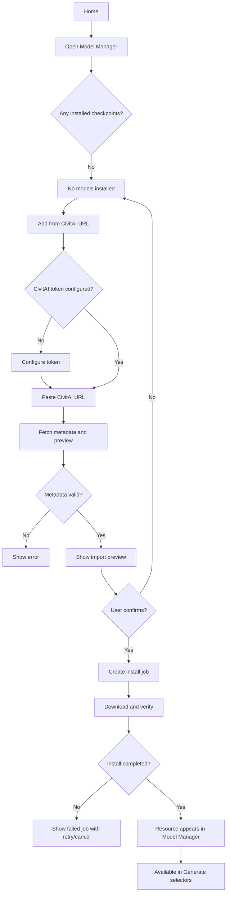
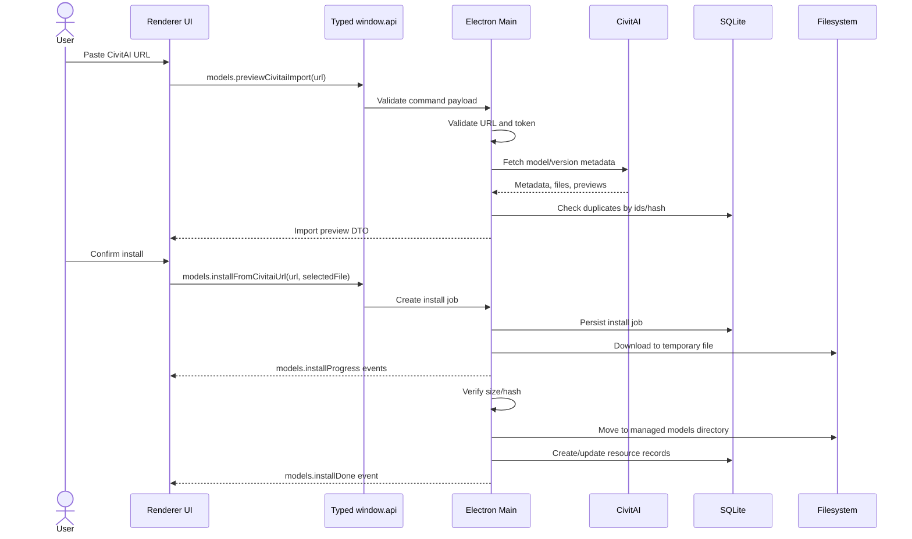
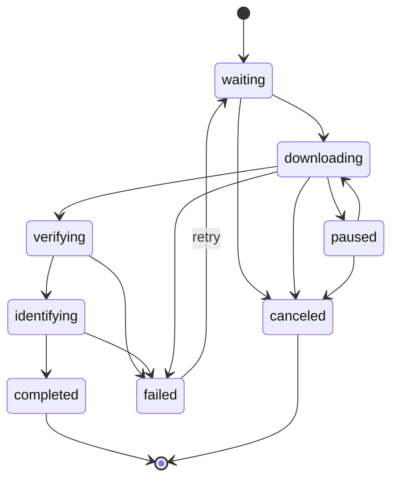
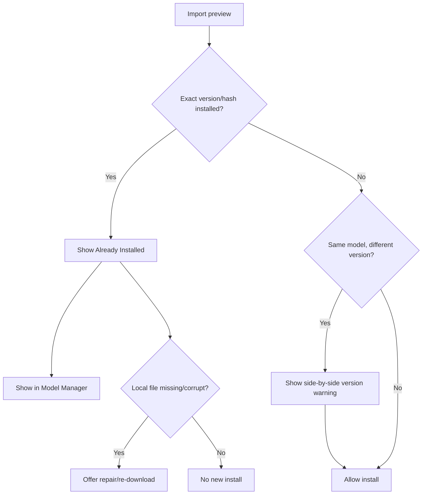
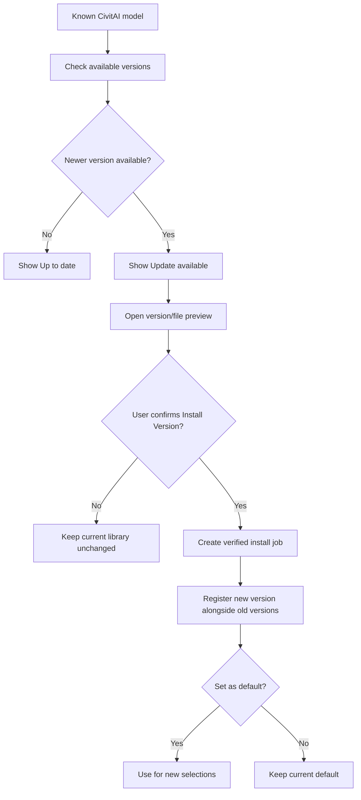
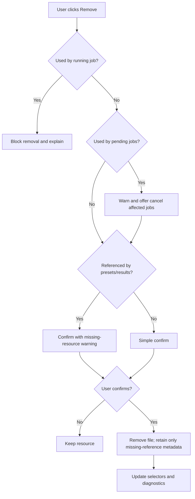
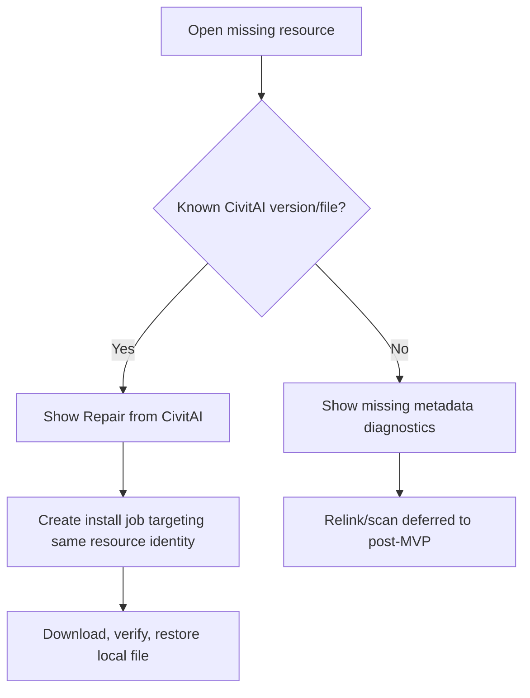
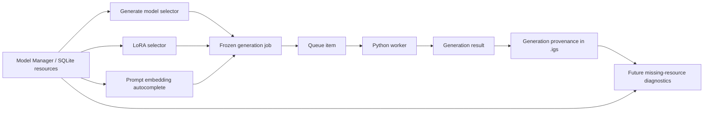

# Model Manager

Feature contract for [PP-004](../product-promises.md#pp-004-управляемая-библиотека-моделей-вместо-ручной-работы-с-файлами).
[Managed Model Library supporting contract](../contracts/managed-model-library.md)
defines the normative resource/version invariants, source metadata boundaries
and negative scope; this document defines the detailed UI and installation flows.

## Feature

Model Manager is the app-level place where the user installs, inspects, repairs, removes and selects reusable generation resources:

- checkpoints / main models;
- LoRAs;
- textual inversion embeddings;
- VAEs;
- ESRGAN/upscale models;
- future post-MVP resources such as ControlNet models.

It is not a CivitAI marketplace browser in MVP. It is the local manager for installed model resources and model downloads.

## Reference

Primary reference: InvokeAI Model Manager V2 and backend model management system.

Current visual and interaction source of truth: `docs/prototype-app?prototype=model-manager`, plus the same manager opened from Home through `Manage Models`.

The Vue prototype covers the manager shell, browse/import presentation and an
interactive mock version lifecycle: discover an available version, preview it,
install it side by side, explicitly change default and keep existing exact
Project/Preset/Result references unchanged. Resource selection, token popover,
local filter reset, modal behavior, pane resizing and bounded scrolling are
also interactive. Model-type/status/base-model filters do not yet filter all
mock rows; storage, real install/repair, queue advancement, token/error and
confirmation states are not production evidence from this prototype.

The separate production Electron Model Manager implements local CivitAI URL
install, exact-version repair, SQLite catalog/queue, manual update check and
default selection. Production Project now selects an installed checkpoint and
exact version from that catalog and preserves the chosen reference in `.igs`.
Worker loading, LoRA/VAE/embedding Project controls and Preset/Result handoff
remain later-phase work.

Useful InvokeAI areas:

- `invokeai/backend/model_manager/README.md` — model lifecycle split into identification, loading/cache and running;
- `invokeai/app/services/model_install/model_install_common.py` — install job sources, statuses and job metadata;
- `invokeai/frontend/web/src/features/modelManagerV2/subpanels/ModelManager.tsx` — list + selected model panel structure;
- `invokeai/frontend/web/src/features/modelManagerV2/subpanels/ModelManagerPanel/ModelListNavigation.tsx` — search/filter/bulk action pattern;
- `invokeai/frontend/web/src/features/modelManagerV2/subpanels/ModelManagerPanel/ModelListItem.tsx` — compact list rows with thumbnail, badges and missing-file warning;
- `invokeai/frontend/web/src/features/modelManagerV2/subpanels/AddModelPanel/InstallModelForm.tsx` — install from URL/local path pattern;
- `invokeai/frontend/web/src/features/modelManagerV2/subpanels/AddModelPanel/ModelInstallQueue/ModelInstallQueue.tsx` — install queue with pause/resume/cancel/prune actions;
- `invokeai/frontend/web/src/features/modelManagerV2/subpanels/ModelPanel/ModelView.tsx` — model detail panel, metadata, default settings and action buttons.

Secondary reference: Forge extra-network cards for rich LoRA/embedding metadata, previews, trigger words and compact resource cards.

## Existing Project Context

Model Manager must follow the project-wide InvokeAI-first / no-NIH policy.

Already fixed project decisions:

- Electron main process owns model management, filesystem, SQLite, downloads, validation and worker process boundaries.
- Renderer talks to model management only through typed `window.api`.
- SQLite is the source of truth for installed reusable resources.
- Heavy resource files live on disk, not in SQLite and not inside `.igs` by default.
- `.igs` projects store model references and compatibility metadata, not copied model weights.
- MVP user-initiated model import starts from CivitAI URLs only; supported
  models may install required companion artifacts as part of the same confirmed
  install group.
- CivitAI API token is required for CivitAI download.
- The main process persists that token through Electron `safeStorage`, never
  through SQLite, `.igs` or plaintext app config. On Linux, `basic_text` or an
  unavailable secure storage backend cannot be used to save a token.
- CivitAI in-app search / marketplace browsing is not MVP.
- SDXL/Illustrious-like `.safetensors` files remain source files; the worker loads them through the Invoke-like Diffusers single-file path and caches loaded components in RAM/VRAM.
- Illustrious and Anima are the supported MVP checkpoint families. Any supported
  CivitAI `.safetensors` checkpoint in either family can be installed. The exact
  CivitAI `NoobAI` label maps to the Illustrious family while its raw source label
  remains unchanged; arbitrary SDXL and Pony checkpoints remain unsupported.
  Standalone VAE applicability follows its separate
  [managed-model contract](../contracts/managed-model-library.md#source-metadata-и-пользовательские-настройки).
  Anima
  uses a separate rectified-flow path. Each supported custom Anima checkpoint
  is installed with pinned Qwen3 encoder and VAE. This pairing does not prove
  structural compatibility; Generate checks it separately.
- ImageGen Studio is a free open-source application and does not bundle model
  weights. The Anima Base 1.0 weights have separate
  [CircleStone Non-Commercial License](https://huggingface.co/circlestone-labs/Anima/blob/main/LICENSE.md)
  terms and are supported only for non-commercial, non-production use. An
  arbitrary CivitAI derivative must show its own source terms, alongside the
  pinned components' terms; the Base 1.0 checkpoint license is not assigned to
  every derivative merely because its family is Anima.
- Model metadata includes `baseModelFamily`. Illustrious/SDXL `predictionType`
  override is keyed by exact SHA-256 and size, separate from source-owned metadata.
  With no explicitly known value, Model Manager offers editable `epsilon` as a
  labeled assumption, not a claim about training. Project displays the current
  effective type read-only; its saved snapshot does not control future inference.
  SHA-256 verifies file identity
  and integrity, not membership in a generation allowlist. Anima does not use an
  SDXL prediction type; Generate requires structural and compatible-component
  checks for its separate rectified-flow pipeline.
- Missing model/LoRA/embedding resources must be diagnosable when applying presets or viewing accepted-result provenance/comparison.

## ImageGen Studio Decision

Build an app-level Model Manager that feels like a compact desktop resource manager, not a web marketplace.

Model Manager follows [PP-002](../product-promises.md#pp-002-явное-намерение-вместо-магического-control), [PP-003](../product-promises.md#pp-003-одна-сущность-один-владелец-и-одно-каноническое-место) and [PP-004](../product-promises.md#pp-004-управляемая-библиотека-моделей-вместо-ручной-работы-с-файлами): search only narrows the installed catalog, each install/import source has an explicit flow, every entry point opens the same canonical manager state, and model files/versions are managed resources rather than a user-maintained folder convention. The UI must not infer search, URL install, local file import or folder scan from one polymorphic input.

Model Manager should borrow InvokeAI's durable mechanics:

- model resource taxonomy;
- identification metadata;
- install queue;
- missing-file status;
- search and filters;
- model detail panel;
- default model settings where useful;
- install/repair/remove actions;
- resource cards used by Generate selectors.

But adapt the product shape:

- CivitAI URL-first import in MVP;
- no marketplace browsing;
- no generic HuggingFace install UI in MVP;
- no local arbitrary file import in MVP unless explicitly promoted from later scope;
- no hidden destructive conversion to Diffusers directories;
- no project-specific model storage;
- no undo/redo for Model Manager actions.

## Entry Points

Model Manager is an app-level overlay, not a `Project` tab.

Required entry points:

- `Manage Models` in the Home sidebar Tools area: opens Model Manager over the mounted Home surface.
- `Project` top menu/context menu: opens Model Manager.
- Generate `Model` selector: `Manage Models` opens Model Manager focused on checkpoints.
- Generate `LoRAs` section: `Manage LoRAs` opens the LoRA category; each selected row has an `Open <name> in Models` action focused on its exact version.
- Generate `VAE` control: `Open in Models` opens the VAE category, focused on the exact external version when present; Embedded still opens VAE browsing. Anima keeps its pinned VAE.
- An embedding token or unified prompt autocomplete action can open Model Manager focused on embeddings.
- Missing resource warning from a preset/accepted result: opens Model Manager filtered to the missing resource identity where possible.

Opening Model Manager should not close the current `Project` tab, should not affect project undo/redo and should not mutate active generation settings unless the user explicitly chooses a model/resource from a Generate selector.

Project entries reset incompatible search, family and status filters to the requested category, even when no resource is selected. Exact saved version focus is separate from library Default; missing IDs remain diagnostics. Closing with the close button or Escape refreshes the Project catalog and returns focus to the existing trigger. A saved embedding Manage action stays mounted while the catalog is checking; a resolved diagnostic can disappear after repair. Catalog refresh does not select new resources or write Project settings. [Production evidence](../engineering/phase-2c-resource-handoff-research.md).

As demonstrated from Home, Model Manager opens as a native Naive modal overlay with restrained enter/leave transitions. The document surface underneath is inert while it is open. The explicit close action and `Esc` both close the manager; `Esc` is temporarily owned by a nested import dialog while that dialog is open.

Presentation reads belong to their modal opening and request: older catalog,
jobs, storage or token responses and errors cannot replace a newer opening's
state. An older refresh cannot clear a newer loading indicator or scroll the
current selection. A pending jobs list retains Main's untouched rows while
preserving row updates observed during that read. Successful token Save/Remove
invalidates older status reads. Closing does not cancel installations or other
Main commands. [Read-ordering evidence](../engineering/phase-2c-model-manager-read-research.md)
qualifies these presentation boundaries separately from installation and secret
storage.

## Information Architecture

Use an app-level overlay with a three-column operational layout:

```text
Model Manager
├─ Header
│  ├─ title and description tooltip
│  ├─ CivitAI token status pill
│  ├─ Add from CivitAI URL
│  └─ close
├─ Left Navigation
│  ├─ Model Types: All Models, Checkpoints, LoRA, Embeddings, VAE, Upscalers
│  ├─ Status filters: All, Installed, Downloading, Needs Attention
│  └─ Models use summary with Open Folder
├─ Resource List Panel
│  ├─ Name search
│  ├─ Base model filter
│  ├─ Sort by select
│  ├─ Reset filters
│  ├─ installed / missing / downloading resources
│  └─ compact install strip
├─ Details Panel
│  ├─ preview
│  ├─ identity and metadata
│  ├─ installed versions
│  ├─ trigger words when available
│  ├─ local file status
│  └─ actions
└─ Import Dialog
   ├─ CivitAI URL
   ├─ import preview
   └─ install / cancel
```

The divider after Left Navigation and the divider before Details Panel are mouse-resizable with bounded minimum and maximum widths. The resource list receives the remaining space; resizing does not change filters or the selected resource.

### Header

The header should include:

- title with a compact `About Model Manager` tooltip rather than a permanently visible subtitle;
- compact CivitAI token status pill;
- `Add from CivitAI URL` primary action;
- close action.

The header should stay task-focused. It should not contain marketplace discovery, featured models, recommendations or promotional content in MVP.

The CivitAI token status pill is the persistent entry point for token management:

- connected state: `CivitAI connected`;
- missing state: `CivitAI token needed`;
- failed state: `CivitAI connection failed`;
- click opens a compact popover with `Change token`, `Remove token` and `Check connection`;
- if the user clicks `Add from CivitAI URL` without a valid token, the same token setup flow is shown before URL preview.

The token is encrypted/decrypted only in Electron main process through
`safeStorage`. If Linux reports the insecure `basic_text` backend or no secure
storage is available, token setup reports why saving is unavailable and does
not persist or silently reuse plaintext. The connected status requires a
securely stored, usable token; token-dependent import stays unavailable until
that condition is met. The Vue prototype models the status UI only, not OS
secret storage.

Do not add a separate always-visible `Storage` button in the header for MVP. The planned storage action is `Open Folder` in the side summary. More advanced storage settings should not be promoted until they become real product scope.

`Add from CivitAI URL` opens a dedicated import dialog. Import preview must not be shown permanently inside the selected-model details panel, because that makes it look like metadata for the currently selected model.

### Left Navigation

The left navigation owns broad filtering and compact status summaries.

Model type filters:

- `All Models`;
- `Checkpoints`;
- `LoRA`;
- `Embeddings`;
- `VAE`;
- `Upscalers`.

Each Model Types option shows its catalog resource count. The prototype uses fixed summary counts for a broader implied library while rendering only six representative rows; production counts must be derived from the same catalog query as the filters.

Status filters:

- `All`;
- `Installed`;
- `Downloading`;
- `Needs Attention`.

Each Status option shows its catalog resource count under the same rule.

The bottom side summary shows:

- `Models use` with the total size of managed model files;
- `Open Folder`.

The side summary is not a full storage settings page. It is a compact utility area.

### Resource List Toolbar

The resource list toolbar owns day-to-day search and narrowing:

- `Name` search input with `Search models` placeholder;
- `Base model` family filter with `All` as the default;
- `Sort by` select with `Name`, `Recently installed` and `Size` options;
- persistent `Reset filters` action, disabled when no non-default filter is active.

`Search models` is a read-only catalog filter. It never parses a CivitAI URL,
local file path, folder path or Hugging Face repository and never starts an
install. Those sources use separately labelled actions and validation flows.

The current visual prototype intentionally does not apply these filters to mock resources, but the controls retain coherent local state. `Reset filters` clears search and restores Model Types, Status and base model filters to their `All` values; it does not reset sorting. Production filtering remains required by the list behavior below.

Do not duplicate Model Types/Status filters in the header.

### Resource List

Each row should show:

- thumbnail / preview;
- model display name;
- version name when available;
- resource type badge;
- compact metadata badges relevant to that resource, such as base model family or trigger-word availability;
- status badge;
- file size;
- missing-file warning when DB metadata exists but the local file is absent.

The whole primary row surface is one Naive button for pointer and keyboard selection. A contextual action such as `Repair` is a separate sibling button, never nested inside the selection button; activating it must not change the selected resource accidentally.

List-row status treatment follows the prototype:

- installed resources use a bordered success `Installed` tag;
- missing resources keep the warning `File missing` tag adjacent to the `Repair` action;
- verification uses the human-facing `Verifying file` label;
- the selected row uses the narrow primary-color marker at its left edge.

The list should support:

- single selection to show details;
- keyboard selection through the focused row with `Enter` or `Space`;
- sorting by name, recently installed and size;
- search by name, version, trigger phrase, CivitAI id and local filename.

Only selection and filter-state/reset behavior are interactive in the current mock. Actual search/filter/sort result mutation belongs to production implementation and must follow the rules above.

### Details Panel

The selected resource detail panel follows the prototype's compact structure.

Visible MVP detail content:

- preview image;
- display name;
- short description;
- status/type/base-model badges;
- for Illustrious checkpoints, the exact file's selected prediction type, its
  known/default/user-chosen status, and an editable `epsilon`/`v-pred` control
  with a short explanation; no SDXL prediction control for Anima;
- installed versions;
- selected/default version;
- managed file name;
- version/file size;
- usage summary, for example presets and accepted project results.

For LoRA and embeddings, the same details area exposes trigger words / activation tokens in a dedicated `Trigger Words` card.

The visible `Metadata` card contains `Version`, `File` and `Used by`. It does not show a `Source` field in MVP because URL installation is CivitAI-only; the CivitAI identity remains available through internal metadata and the `Copy Link` action.

Do not expose local resource id, file hash, loader internals or full diagnostics in the default details view. Those can exist behind diagnostics / `Show details` later, but are not part of the visible MVP action grid.

Actions:

- copy CivitAI link;
- reveal file in folder;
- remove local resource;

Visible action layout:

- `Copy Link` spans the full action grid width;
- `Show in Folder` and `Remove` appear below as a two-button row.

Contextual actions:

- missing resources can show `Repair` directly in the resource row;
- lower-level actions such as copy hash, re-identify local file, edit metadata and diagnostics should not be visible in the default detail action grid for MVP.

Do not expose low-level loader internals as primary UI. They can appear in diagnostics/dev details only.

### Installed Versions

Several versions of one CivitAI model can be installed side by side.

The version list in Details Panel should use explicit actions:

- the default version shows `Default`;
- inactive installed versions use `Set Default`;
- installing another version uses `Install Version`;
- each version has a compact info action that opens its explanatory note in a popover;
- avoid vague labels such as `Show` when the action changes default selection behavior.

Version discovery and update installation are part of MVP:

- Model Manager checks the known CivitAI model identity for available versions;
- a resource with a newer available version shows an explicit `Update available`
  state;
- opening that state shows the target version and file metadata before download;
- `Install Version` creates an ordinary Model Manager install job;
- the new version is installed alongside existing versions and never overwrites
  or silently removes them;
- the user explicitly chooses whether the newly installed version becomes
  `Default`.

Automatic check scheduling and caching are implementation details. Applying an
update is always explicit: MVP does not silently download, install or select a
new version.

Default version is only a starting point for new model selections. It must not silently change existing projects, presets or accepted-result provenance.

Project / Generate owns the actual selected version for a project. The model card
in Generate must expose a `Version` select for the selected model. The first
installed version becomes the initial default; later new selections use the
version explicitly marked `Default`. An existing project can keep or switch to
any installed version explicitly.

Do not add a separate visible `Refresh Info` / `Update Metadata` action in MVP.
The version check may refresh the current source snapshot as supporting data, but
metadata refresh is not a second primary action and never mutates copied
accepted-result provenance.

## MVP Scope

MVP includes:

- open Model Manager from Home, Project and Generate selectors;
- list installed resources from SQLite;
- install from CivitAI URL;
- require active CivitAI API token before download;
- fetch CivitAI metadata and preview before download;
- show an import preview before starting the install;
- for Anima, show the checkpoint, pinned Qwen3 encoder/VAE and total additional
  download size before joint installation; explain that structural compatibility
  is checked separately before Generate;
- download to a temporary file;
- show download/install progress;
- verify size and hash when available;
- move verified file to managed models directory;
- create SQLite records for model/resource/version/local file;
- store preview/avatar metadata;
- have the worker create derived thumbnail images where needed; main process
  fetches CivitAI source previews and owns thumbnail/cache publication;
- detect duplicate already-installed resources by CivitAI version id and/or file hash;
- detect newer versions for a known CivitAI model identity;
- show an explicit available-update state;
- preview and install another version side by side without overwriting installed versions;
- allow the user to set the default version for new selections;
- preserve exact version references in existing projects, presets and provenance;
- show resource details;
- show missing-file status;
- repair a missing known CivitAI resource by re-downloading its exact version;
- remove local resource with confirmation;
- prevent deletion while resource is currently used by a running job;
- keep presets/accepted-result provenance readable after deletion by storing copied human-readable resource metadata;
- expose installed resources to the Generate model and LoRA selectors and unified prompt autocomplete;
- show compatibility warnings for active model family mismatch.

## Post-MVP / Later

Post-MVP:

- local file import by path/hash;
- scan folder for models;
- manual relink and folder-scan repair for missing local files; MVP may repair a known CivitAI resource by re-downloading the exact version;
- bulk actions;
- richer model relationships;
- optional non-destructive disk cache for expensive model conversion or cold-load optimization;
- ControlNet resources once ControlNet itself is added after MVP.
- LoRA training workspace inspired by `LoRA_Easy_Training_Scripts`, with trained LoRAs registered back into Model Manager.

Rejected for MVP:

- built-in CivitAI marketplace browser;
- silent auto-update;
- automatic installation or default-version switching after update detection;
- installing arbitrary unknown resources without clear metadata;
- hidden destructive conversion from `.safetensors` to Diffusers directory;
- storing reusable model weights inside `.igs`;
- project-local model libraries.

Local file import, folder scan and any future external-catalog search remain
separate user intents even if they share backend identification code. A folder
scan may use an explicit folder field/picker followed by `Scan`; it must not be
activated by pasting a path into model search.

## Core User Flow

### First Run / No Models Installed

1. User opens the app.
2. `Home` shows no installed model state.
3. User clicks `Manage Models`.
4. Model Manager opens with an empty model-list state.
5. Empty state explains that the user needs to add a model from a CivitAI URL.
6. User clicks `Add from CivitAI URL`.
7. If no CivitAI token is configured, app opens token setup before allowing download.
8. User configures token.
9. User pastes a CivitAI model/version URL.
10. App validates URL and fetches metadata.
11. App shows import preview.
12. User confirms.
13. Install job appears in install queue.
14. When completed, model appears in resource list and becomes selectable in Generate.



### Add From CivitAI URL

The import flow is preview-first. The app should not start downloading a large model before the user sees what will be installed.

For Anima, the CivitAI URL is still the user-facing install entrypoint. Each
supported custom checkpoint is paired with pinned Qwen3 encoder and VAE in one
confirmed install group. The import preview lists the files and total bytes
for that group before download; failure/cancel publishes no partial group.
Verified shared companions can be reused and remain while another installed
model needs them. Their installation does not prove the checkpoint's structural
compatibility; Generate becomes available only after the exact checkpoint
structure and components are checked. The preview shows the selected checkpoint
and pinned components' sources and applicable terms, without assuming every
Anima derivative has the Base 1.0 checkpoint license. A missing companion later blocks
generation until that exact dependency is repaired.

Validation steps:

- parse supported CivitAI URL forms;
- extract model id / model version id where possible;
- require API token;
- fetch model/version metadata;
- select downloadable file;
- detect resource type from metadata and file name where possible;
- detect duplicate local resource;
- show preview with name, author, version, type, base model, file size, preview image and CivitAI URL.

The user can cancel before the install job is created.



### Install Queue

Model downloads can be long-running. Treat install jobs as first-class state, not as invisible toasts.

Model downloads belong to Model Manager. The app chrome download activity button opens Model Manager focused on the `Downloading` status / install queue. It does not open a separate Download Manager in MVP.

Generation and upscale jobs use the separate Queue Manager described in `docs/features/queue-manager.md`.

Install job statuses:

```ts
type ModelInstallStatus =
  | 'waiting'
  | 'downloading'
  | 'paused'
  | 'verifying'
  | 'identifying'
  | 'completed'
  | 'failed'
  | 'canceled'
```

Each install queue row should show:

- thumbnail/name/version if metadata is known;
- target file;
- downloaded bytes / total bytes;
- progress percent;
- current status;
- pause/resume when supported;
- cancel;
- retry failed;
- reveal error details.

The compact install strip should use an explicit `View Queue` button. Avoid a bare `Queue` label, because it does not explain whether it opens the queue, adds something to the queue or changes current item state.

The strip follows the current prototype layout:

- installation title on its own first line;
- full-width progress bar for the remaining center-column space;
- small downloaded/total size line under the progress bar;
- `Cancel` and `View Queue` actions grouped on the right.

Bulk queue actions:

- pause all active downloads;
- resume all paused downloads;
- cancel all cancelable jobs;
- clear completed/failed/canceled jobs.

MVP can implement only cancel/retry/clear if pause/resume adds too much risk, but the user flow should be designed around a queue, not one-off modal progress.



### Duplicate Install

When the user imports a resource that appears to be already installed:

- if exact CivitAI model version id and file hash match, show `Already installed`;
- do not download again by default;
- offer `Show in Model Manager`;
- offer `Re-download / repair` only if the local file is missing, corrupted or user explicitly chooses reinstall.

If same CivitAI model but different version:

- treat it as a different generation resource;
- show a warning that presets/accepted results require exact version matches;
- allow installing side-by-side.



### Install New Version

An available update is not a special destructive operation. It is another exact
model version installed through the same verified install pipeline.



The update flow must preserve three identities separately:

- the CivitAI model identity used to discover related versions;
- the exact installed model-version/file identity;
- each Project/Preset/provenance reference to the version it actually selected.

Checking or installing an update cannot rewrite the third identity.

### Remove Local Resource

Removing a model removes the local reusable resource, but does not rewrite history.

This is a hard removal, with no Model Manager Trash, restore window or
soft-deleted model record. Minimal copied identity/display metadata can remain
solely to explain missing references in Projects, Presets and provenance; it is
not an installed or restorable resource. Repair is a new verified download of
the exact resource. Removing an Anima checkpoint must not delete a companion
still used by another installed model.

Rules:

- if the resource is used by a running generation/upscale job, deletion is blocked;
- if used by pending jobs, warn and ask whether to cancel affected jobs first;
- if referenced by presets or `.igs` accepted-result provenance, deletion is allowed only after confirmation;
- accepted results remain readable because provenance stores copied human-readable metadata;
- after deletion, selectors and presets show missing-resource diagnostics.



### Missing Resource Repair

A resource is `missing` when SQLite metadata exists but the local file is absent or fails verification.

Repair options:

- re-download from CivitAI if `civitaiModelVersionId` and file metadata are known;
- later: relink local file by hash;
- later: scan folder.

MVP repair can be limited to CivitAI re-download.



## Integration With Generate

Generate mode must consume Model Manager state, not duplicate it.

Main model selector:

- reads installed checkpoints from Model Manager;
- filters by supported base model family;
- shows missing/incompatible status;
- opens Model Manager through `Manage Models`;
- can focus the selected model in Model Manager.

LoRA selector:

- reads installed LoRAs from Model Manager;
- shows thumbnails directly in dropdown rows;
- shows trigger words and base model family;
- opens detail popover from explicit info button;
- opens Model Manager through `Manage Models`.

Embedding references in plain-text prompts:

- unified prompt autocomplete reads installed embeddings from Model Manager;
- embedding reference metadata shows activation/negative tokens;
- opens detail popover from explicit info button;
- opens Model Manager through `Manage Models`.

Accepted-result provenance:

- store resource ids and copied human-readable metadata;
- are not mutated when a model is renamed, removed or updated;
- can resolve current local resources by id/hash/CivitAI version;
- show missing resource diagnostics when exact resource is not available.



## Data Model Expectations

The exact schema can evolve during implementation, but the user flow assumes these logical records:

```text
model_resource
├─ id
├─ type
├─ display_name
├─ description
├─ thumbnail_path / thumbnail_cache_key
├─ civitai_model_id
├─ source_metadata_json
├─ source_checked_at
├─ created_at
└─ updated_at

model_resource_version
├─ id
├─ model_resource_id
├─ version_name
├─ civitai_model_version_id
├─ base_model_family
├─ format
├─ prediction_type
├─ file_hash
├─ is_default
├─ source_metadata_json
├─ created_at
└─ updated_at

local_model_file
├─ id
├─ resource_version_id
├─ managed_path
├─ original_filename
├─ size_bytes
├─ hash
├─ status
└─ verified_at

model_install_job
├─ id
├─ download_url
├─ target_resource_version_id
├─ status
├─ bytes_downloaded
├─ total_bytes
├─ error_code
├─ error_message
├─ preview_payload_json
├─ created_at
└─ updated_at
```

For every model resource with installed versions, exactly one installed version
is the catalog default. This is a preference for new selections, not a mutable
alias used by persisted resource references.

## Error Handling

Use clear, task-level messages. Do not expose raw stack traces by default.

MVP examples:

```text
Не удалось получить данные модели.
CivitAI API token недействителен.
Файл модели недоступен.
Модель уже установлена.
Скачанный файл не прошёл проверку hash.
Файл модели отсутствует на диске.
Нельзя удалить модель, пока она используется активной задачей.
```

Detailed technical errors can be available behind `Show details` for debugging and bug reports.

## Vue Prototype Coverage

The current Vue/Naive prototype is authoritative for the visible three-pane composition and demonstrates:

- standalone `?prototype=model-manager` and Home `Manage Models` entry points;
- default browse state with `Illustrious XL` selected, `All Models` / `All` / base model `All` filters and `Name` sort;
- native modal enter/leave transition, explicit close, `Esc` close and inert Home backdrop;
- `About Model Manager` tooltip and connected-token popover;
- model-type/status navigation, search/base-model/sort controls and reset-state behavior;
- full-row pointer/keyboard resource selection with a separate non-selecting `Repair` action;
- bounded mouse resizing of Left Navigation and Details Panel;
- selected-resource preview, versions, trigger words, metadata and action layout;
- `Add from CivitAI URL` dialog with a URL field and import preview;
- compact in-progress install strip.

It now models `Update available` -> version preview -> side-by-side install ->
optional `Set Default`, with mock Project/Preset/Result references pinned to their
original exact versions. Cancellation does not apply a late install. Filters do
not mutate all mock rows, and prototype storage, real download/repair/remove,
queue advancement, token/error/empty states remain outside this interaction
coverage. Production acceptance criteria below require separate evidence.

The Vue prototype still shows prediction type as read-only. The production
Electron Model Manager now offers a per-exact-file Illustrious prediction control:
an explicit choice overrides the verified manifest value or the labeled
`epsilon` assumption. It installs supported CivitAI Anima checkpoints together
with pinned Qwen3/VAE companions; the official Base license is attributed only
to matching checkpoint bytes. Electron smoke covers the Model Manager control and
Project read-only display. The `.igs` value is advisory for future inference;
Prepare takes the current effective type. The production import dialog shows
the selected file's download estimate and the pinned companions' CircleStone
terms; custom checkpoint terms remain source-specific. SQLite/filesystem tests
cover rollback of a late Anima install failure after preparing a companion
repair. Structural qualification and inference in the worker remain open.

The App Chrome downloads icon is visually present but not wired to Model Manager in the prototype; `Manage Models` on Home and the standalone query are the implemented entry points.

## Acceptance Criteria

The following criteria describe the production feature; prototype-only coverage is listed separately above.

- User can open Model Manager from Home.
- User can open Model Manager from Project/global menu.
- User can open Model Manager from Generate model/LoRA controls and embedding-token diagnostics.
- User can paste a CivitAI URL and see import preview before downloading.
- Import is blocked until CivitAI token is configured.
- Linux cannot persist a token with `safeStorage`'s `basic_text` backend or a
  plaintext fallback; token setup explains secure-storage unavailability.
- A supported CivitAI Illustrious/Anima `.safetensors` checkpoint can be
  installed without an app-owned checkpoint-hash allowlist. All custom Anima
  installs show the pinned Qwen3/VAE group and total additional download size;
  Generate still requires structural and component checks.
- Each installed artifact's source terms are shown before install; the CircleStone
  restriction is shown for its Base 1.0 weights, not inferred for every derivative.
- The user can edit Illustrious prediction type only in Model Manager, per exact
  SHA-256 and size. An `epsilon` default with no known value is visibly labeled
  as an assumption. A library edit affects subsequent Prepare for that file,
  without rewriting `.igs`, Presets, frozen jobs or accepted provenance.
- User can start model install and see it in an install queue.
- Download progress is visible and survives Model Manager close/reopen during the app session.
- Completed install creates SQLite resource records and a managed local file.
- Installed checkpoint appears in Generate model selector.
- Installed LoRA appears in LoRA selector with thumbnail metadata when available.
- Installed embedding appears in unified prompt autocomplete with token metadata when available.
- Duplicate exact resource install does not download again by default.
- Model Manager can detect and display an available CivitAI version.
- User can preview and install another version of the same model.
- The new version is installed side by side and does not overwrite the old version.
- User can explicitly set an installed version as the default for new selections.
- Existing Projects, Presets and accepted-result provenance keep their exact version after install/default changes.
- No version is downloaded, installed, selected or removed by a silent update.
- Missing local file is shown as a missing resource state.
- Remove is blocked for resources used by running jobs.
- Remove confirmation warns when resource is referenced by presets/accepted results.
- Accepted-result provenance remains readable after a resource is removed.
- Removing a model has no soft-delete/Restore lifecycle; missing references
  retain diagnostics, and shared Anima companions remain while still used.
- Model Manager actions are not part of project undo/redo.
